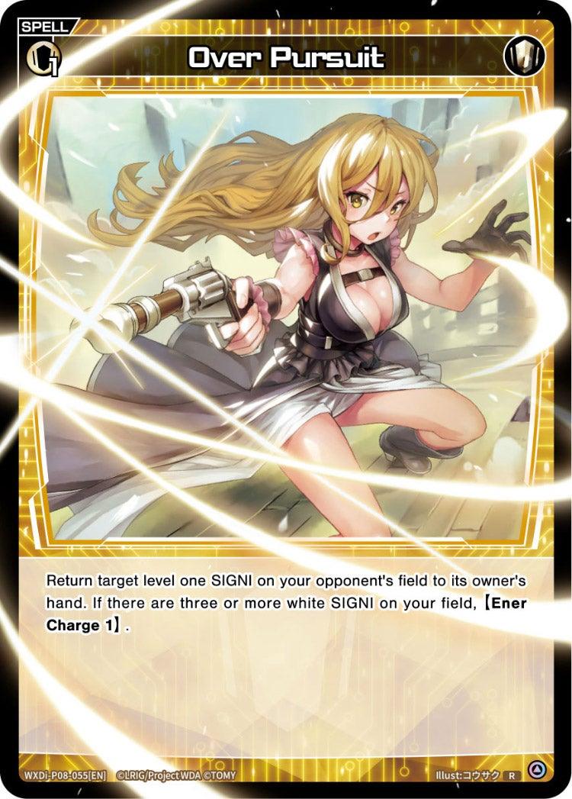

# Over Pursuit

## Thông tin lá

| Trường | Giá trị |
| --- | --- |
| Mã in | WXDi-P08-055[EN] |
| Set | WXDi-P08[EN] |
| Số thứ tự | 055 |
| Loại thẻ | SPELL |
| Vị trí | Main Deck |
| Số bản | — (set booster, không áp dụng) |
| Màu | Trắng |
| Độ hiếm | R,R(P) |
| Minh họa | コウサク |
| Level | — |
| Limit | — |
| Power | 0 |
| LRIG type / Class | — |
| Team / Master | — |
| Cost | 《W》×１ |
| Grow cost | — |
| Use timing | — |
| Life Burst | Không |

## Card text chính thức

Return target level one SIGNI on your opponent's field to its owner's hand. If there are three or more white SIGNI on your field, 【Ener Charge 1】.

## Power text / Life Burst

—

## Ghi chú minh họa
Artist: コウサク. Ảnh R được tải từ Card List tiếng Anh.

## FAQ chính thức

**Q. May I [Ener Charge 1] even if my opponent doesn't have a Level one SIGNI on their field, as long as I have three or more white SIGNI on my field?**
A. Yes, you can. The latter effect can be resolved regardless of the result of the first effect.

## Ảnh biến thể

- [R(P)](../images/WXDi-P08-055P-EN.jpg)

## Nguồn
[Card List/FAQ chính thức](https://www.takaratomy.co.jp/products/en.wixoss/card/card.html?card_no=WXDi-P08-055%5BEN%5D ) · [Ảnh thẻ](https://www.takaratomy.co.jp/products/en.wixoss/card/thumb/WXDi-P08-055%5BEN%5D.jpg)
