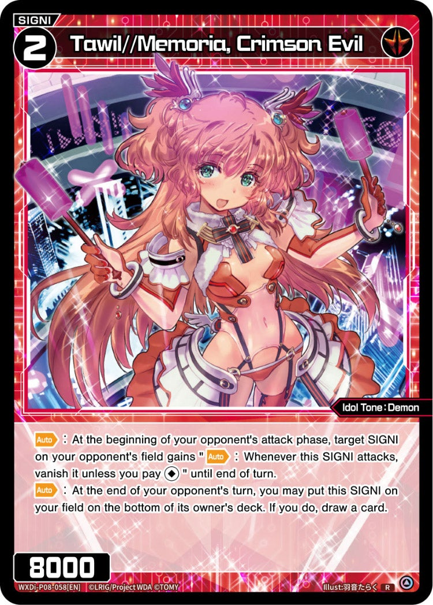

# Tawil//Memoria, Crimson Evil

## Thông tin lá

| Trường | Giá trị |
| --- | --- |
| Mã in | WXDi-P08-058[EN] |
| Set | WXDi-P08[EN] |
| Số thứ tự | 058 |
| Loại thẻ | SIGNI |
| Vị trí | Main Deck |
| Số bản | — (set booster, không áp dụng) |
| Màu | Đỏ |
| Độ hiếm | R,R(P) |
| Minh họa | 羽音たらく |
| Level | 2 |
| Limit | — |
| Power | 8000 |
| LRIG type / Class | Idol Tone：Demon |
| Team / Master | — |
| Cost | — |
| Grow cost | — |
| Use timing | — |
| Life Burst | Không |

## Card text chính thức

[Auto]: At the beginning of your opponent's attack phase, target SIGNI on your opponent's field gains "[Auto]: Whenever this SIGNI attacks, vanish it unless you pay {Colorless}" until end of turn.
[Auto]: At the end of your opponent's turn, you may put this SIGNI on your field on the bottom of its owner's deck. If you do, draw a card.

## Power text / Life Burst

—

## Ghi chú minh họa
Artist: 羽音たらく. Ảnh R được tải từ Card List tiếng Anh.

## FAQ chính thức

**Q. When this SIGNI gives an [Auto] ability to my opponent's SIGNI, which [Auto] ability triggers first: the original "When this attacks" ability, or the newly given ability?**
A. Both [Auto] abilities are triggered when that SIGNI attacks, and since they are both that SIGNI's [Auto] abilities, they can be resolved in any order. Note that once triggered, the abilities will be processed even if the SIGNI is vanished before they are resolved.

## Ảnh biến thể

- [R(P)](../images/WXDi-P08-058P-EN.jpg)

## Nguồn
[Card List/FAQ chính thức](https://www.takaratomy.co.jp/products/en.wixoss/card/card.html?card_no=WXDi-P08-058%5BEN%5D ) · [Ảnh thẻ](https://www.takaratomy.co.jp/products/en.wixoss/card/thumb/WXDi-P08-058%5BEN%5D.jpg)
