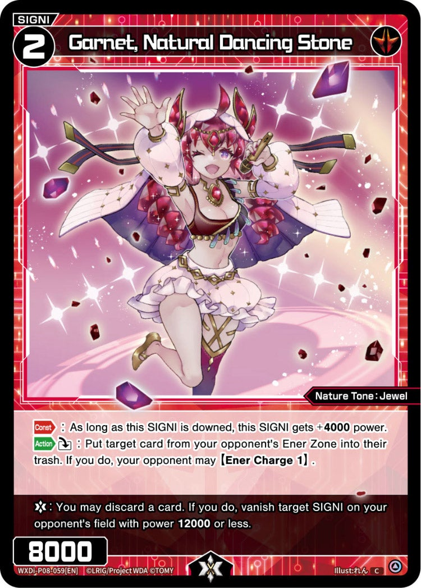

# Garnet, Natural Dancing Stone

## Thông tin lá

| Trường | Giá trị |
| --- | --- |
| Mã in | WXDi-P08-059[EN] |
| Set | WXDi-P08[EN] |
| Số thứ tự | 059 |
| Loại thẻ | SIGNI |
| Vị trí | Main Deck |
| Số bản | — (set booster, không áp dụng) |
| Màu | Đỏ |
| Độ hiếm | C,C(P) |
| Minh họa | れん |
| Level | 2 |
| Limit | — |
| Power | 8000 |
| LRIG type / Class | Nature Tone：Jewel |
| Team / Master | — |
| Cost | — |
| Grow cost | — |
| Use timing | — |
| Life Burst | Có |

## Card text chính thức

[Constant]: As long as this SIGNI is downed, this SIGNI gets +4000 power.
[Action] {Down}: Put target card from your opponent's Ener Zone into their trash. If you do, your opponent may 【Ener Charge 1】.

## Power text / Life Burst

You may discard a card. If you do, vanish target SIGNI on your opponent's field with power 12000 or less.

## Ghi chú minh họa
Artist: れん. Ảnh C được tải từ Card List tiếng Anh.

## FAQ chính thức

**Q. If this SIGNI attacks and battles with the SIGNI in front of it, what will its power become?**
A. When you declare an attack and this SIGNI is downed, its [Const] ability applies and it gets +4000 power. If there are no other effects, it will battle your opposing SIGNI in front of it with power 12000.

## Ảnh biến thể

- [C(P)](../images/WXDi-P08-059P-EN.jpg)

## Nguồn
[Card List/FAQ chính thức](https://www.takaratomy.co.jp/products/en.wixoss/card/card.html?card_no=WXDi-P08-059%5BEN%5D ) · [Ảnh thẻ](https://www.takaratomy.co.jp/products/en.wixoss/card/thumb/WXDi-P08-059%5BEN%5D.jpg)
