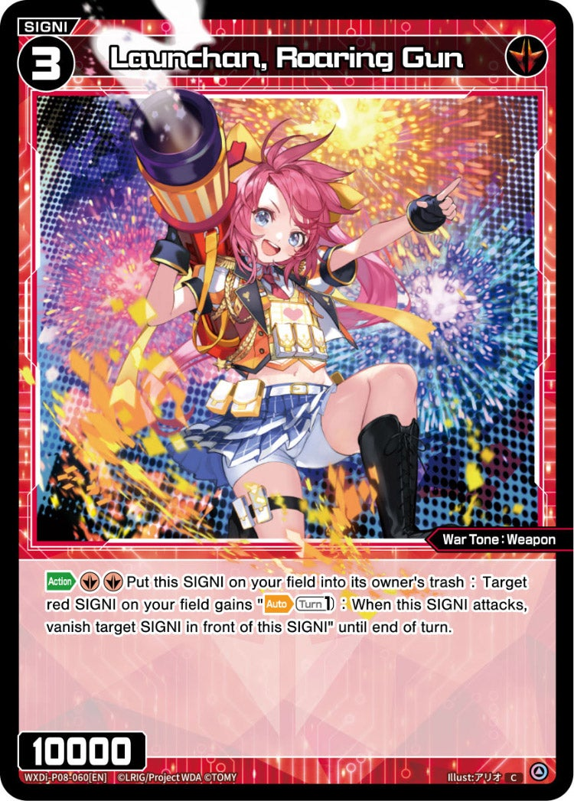

# Launchan, Roaring Gun

## Thông tin lá

| Trường | Giá trị |
| --- | --- |
| Mã in | WXDi-P08-060[EN] |
| Set | WXDi-P08[EN] |
| Số thứ tự | 060 |
| Loại thẻ | SIGNI |
| Vị trí | Main Deck |
| Số bản | — (set booster, không áp dụng) |
| Màu | Đỏ |
| Độ hiếm | C,C(P) |
| Minh họa | アリオ |
| Level | 3 |
| Limit | — |
| Power | 10000 |
| LRIG type / Class | War Tone：Weapon |
| Team / Master | — |
| Cost | — |
| Grow cost | — |
| Use timing | — |
| Life Burst | Không |

## Card text chính thức

[Action] {Red} {Red} Put this SIGNI on your field into its owner's trash: Target red SIGNI on your field gains "[Auto] {1/Turn}: When this SIGNI attacks, vanish target SIGNI in front of this SIGNI" until end of turn.

## Power text / Life Burst

—

## Ghi chú minh họa
Artist: アリオ. Ảnh C được tải từ Card List tiếng Anh.

## FAQ chính thức

**Q. If this SIGNI's [Auto] ability vanishes my opponent's SIGNI in front of it when it attacks, does it deal damage to my opponent?**
A. Yes, if there are no other effects, your opponent's SIGNI in front of that Signi will be vanished, and you will deal damage to your opponent.

## Ảnh biến thể

- [C(P)](../images/WXDi-P08-060P-EN.jpg)

## Nguồn
[Card List/FAQ chính thức](https://www.takaratomy.co.jp/products/en.wixoss/card/card.html?card_no=WXDi-P08-060%5BEN%5D ) · [Ảnh thẻ](https://www.takaratomy.co.jp/products/en.wixoss/card/thumb/WXDi-P08-060%5BEN%5D.jpg)
