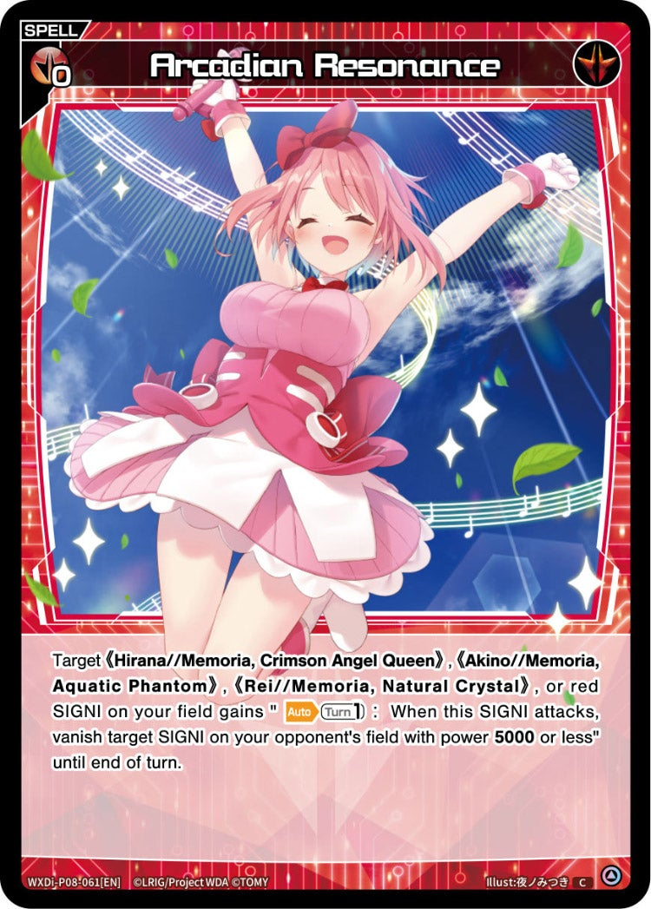

# Arcadian Resonance

## Thông tin lá

| Trường | Giá trị |
| --- | --- |
| Mã in | WXDi-P08-061[EN] |
| Set | WXDi-P08[EN] |
| Số thứ tự | 061 |
| Loại thẻ | SPELL |
| Vị trí | Main Deck |
| Số bản | — (set booster, không áp dụng) |
| Màu | Đỏ |
| Độ hiếm | C,C(P) |
| Minh họa | 夜ノみつき |
| Level | — |
| Limit | — |
| Power | 0 |
| LRIG type / Class | — |
| Team / Master | — |
| Cost | 《R》×０ |
| Grow cost | — |
| Use timing | — |
| Life Burst | Không |

## Card text chính thức

Target 《Hirana//Memoria, Crimson Angel Queen》, 《Akino//Memoria, Phantom Aquatic Beast》, 《Rei//Memoria, Natural Crystal》, or red SIGNI on your field gains "[Auto] {1/Turn}: When this SIGNI attacks, vanish target SIGNI on your opponent's field with power 5000 or less" until end of turn.

## Power text / Life Burst

—

## Ghi chú minh họa
Artist: 夜ノみつき. Ảnh C được tải từ Card List tiếng Anh.

## FAQ chính thức

— (không có FAQ riêng cho mã này trên trang FAQ tiếng Anh.)

## Ảnh biến thể

- [C(P)](../images/WXDi-P08-061P-EN.jpg)

## Nguồn
[Card List/FAQ chính thức](https://www.takaratomy.co.jp/products/en.wixoss/card/card.html?card_no=WXDi-P08-061%5BEN%5D ) · [Ảnh thẻ](https://www.takaratomy.co.jp/products/en.wixoss/card/thumb/WXDi-P08-061%5BEN%5D.jpg)
