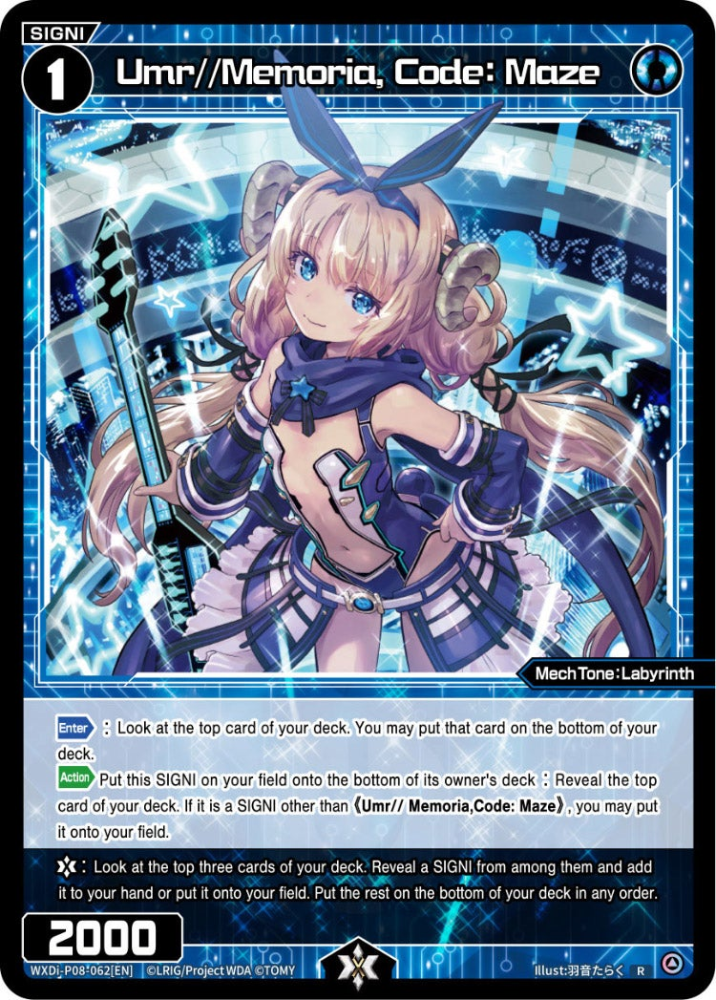

# Umr//Memoria, Code: Maze

## Thông tin lá

| Trường | Giá trị |
| --- | --- |
| Mã in | WXDi-P08-062[EN] |
| Set | WXDi-P08[EN] |
| Số thứ tự | 062 |
| Loại thẻ | SIGNI |
| Vị trí | Main Deck |
| Số bản | — (set booster, không áp dụng) |
| Màu | Xanh dương |
| Độ hiếm | R,R(P) |
| Minh họa | 羽音たらく |
| Level | 1 |
| Limit | — |
| Power | 2000 |
| LRIG type / Class | Mech Tone：Labyrinth |
| Team / Master | — |
| Cost | — |
| Grow cost | — |
| Use timing | — |
| Life Burst | Có |

## Card text chính thức

[Enter]: Look at the top card of your deck. You may put that card on the bottom of your deck.
[Action] Put this SIGNI on your field onto the bottom of its owner's deck: Reveal the top card of your deck. If it is a SIGNI other than 《Umr//Memoria, Code: Maze》, you may put it onto your field.

## Power text / Life Burst

Look at the top three cards of your deck. Reveal a SIGNI from among them and add it to your hand or put it onto your field. Put the rest on the bottom of your deck in any order.

## Ghi chú minh họa
Artist: 羽音たらく. Ảnh R được tải từ Card List tiếng Anh.

## FAQ chính thức

**Q. May I choose the SIGNI zone when I put a SIGNI from the top of my deck onto the field using the [Action] ability?**
A. Yes, you can choose where to put the SIGNI from the top of your deck as long as there is an empty SIGNI zone. It doesn't have to be in the original SIGNI zone. Additionally, if the conditions are met, you can also put a SIGNI with [Rise].

## Ảnh biến thể

- [R(P)](../images/WXDi-P08-062P-EN.jpg)

## Nguồn
[Card List/FAQ chính thức](https://www.takaratomy.co.jp/products/en.wixoss/card/card.html?card_no=WXDi-P08-062%5BEN%5D ) · [Ảnh thẻ](https://www.takaratomy.co.jp/products/en.wixoss/card/thumb/WXDi-P08-062%5BEN%5D.jpg)
