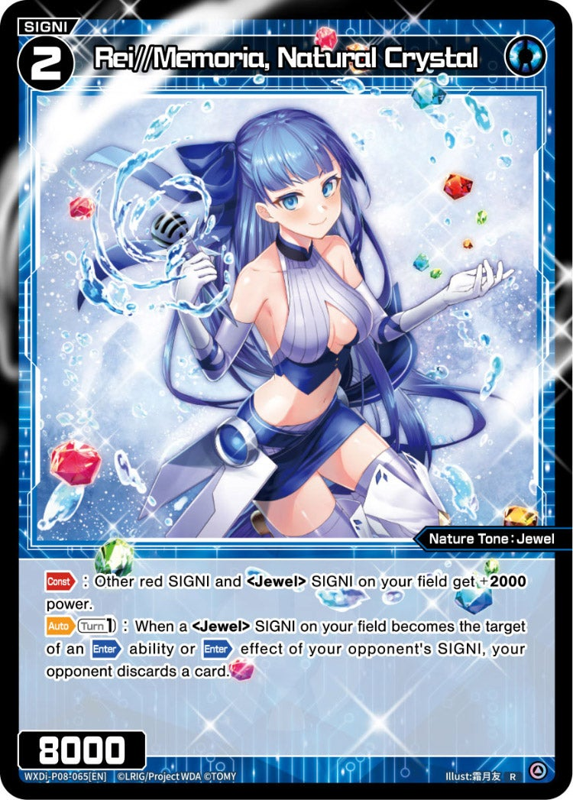

# Rei//Memoria, Natural Crystal

## Thông tin lá

| Trường | Giá trị |
| --- | --- |
| Mã in | WXDi-P08-065[EN] |
| Set | WXDi-P08[EN] |
| Số thứ tự | 065 |
| Loại thẻ | SIGNI |
| Vị trí | Main Deck |
| Số bản | — (set booster, không áp dụng) |
| Màu | Xanh dương |
| Độ hiếm | R,R(P) |
| Minh họa | 霜月友 |
| Level | 2 |
| Limit | — |
| Power | 8000 |
| LRIG type / Class | Nature Tone：Jewel |
| Team / Master | — |
| Cost | — |
| Grow cost | — |
| Use timing | — |
| Life Burst | Không |

## Card text chính thức

[Constant]: Other red SIGNI and <Jewel> SIGNI on your field get +2000 power.
[Auto] {1/Turn}: When a <Jewel> SIGNI on your field becomes the target of an [Enter] ability or [Enter] effect of your opponent's SIGNI, your opponent discards a card.

## Power text / Life Burst

—

## Ghi chú minh họa
Artist: 霜月友. Ảnh R được tải từ Card List tiếng Anh.

## FAQ chính thức

**Q. Do SIGNI that are both red and <Jewel> get +4000 power from this [Const] ability?**
A. No, it gets +2000 power. This is an ability that adds +2000 power when either condition is met, and it will remain +2000 even if both conditions are met.

**Q. Does the [Auto] ability trigger even when this SIGNI itself becomes the target?**
A. Yes, it will trigger.

## Ảnh biến thể

- [R(P)](../images/WXDi-P08-065P-EN.jpg)

## Nguồn
[Card List/FAQ chính thức](https://www.takaratomy.co.jp/products/en.wixoss/card/card.html?card_no=WXDi-P08-065%5BEN%5D ) · [Ảnh thẻ](https://www.takaratomy.co.jp/products/en.wixoss/card/thumb/WXDi-P08-065%5BEN%5D.jpg)
