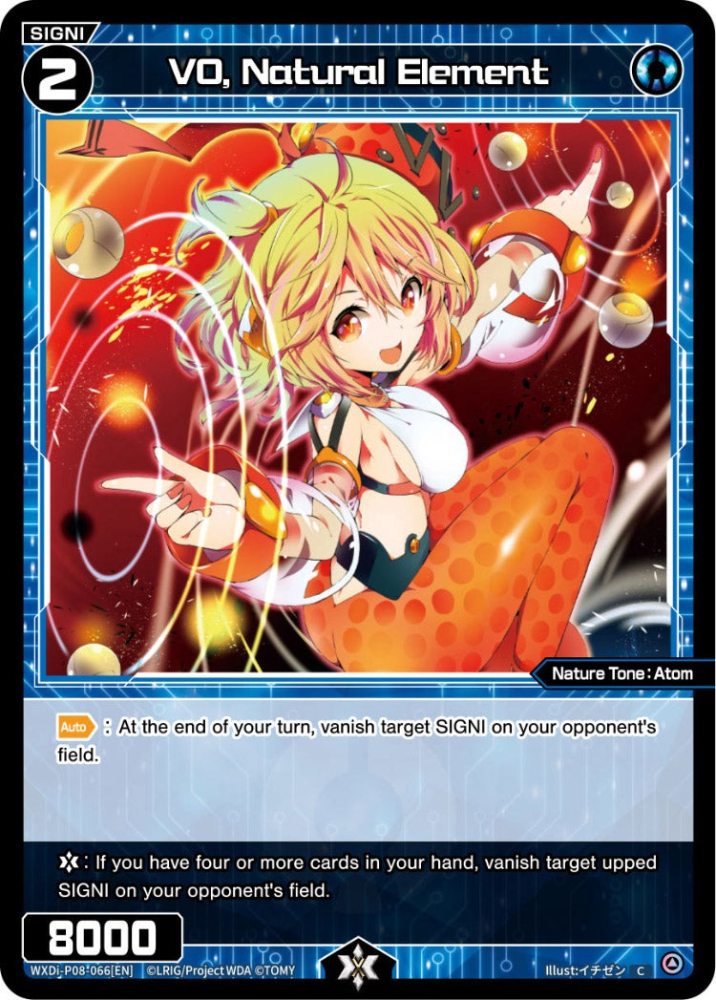

# VO, Natural Element

## Thông tin lá

| Trường | Giá trị |
| --- | --- |
| Mã in | WXDi-P08-066[EN] |
| Set | WXDi-P08[EN] |
| Số thứ tự | 066 |
| Loại thẻ | SIGNI |
| Vị trí | Main Deck |
| Số bản | — (set booster, không áp dụng) |
| Màu | Xanh dương |
| Độ hiếm | C,C(P) |
| Minh họa | イチゼン |
| Level | 2 |
| Limit | — |
| Power | 8000 |
| LRIG type / Class | Nature Tone：Atom |
| Team / Master | — |
| Cost | — |
| Grow cost | — |
| Use timing | — |
| Life Burst | Có |

## Card text chính thức

[Auto]: At the end of your turn, vanish target SIGNI on your opponent's field.

## Power text / Life Burst

If you have four or more cards in your hand, vanish target upped SIGNI on your opponent's field.

## Ghi chú minh họa
Artist: イチゼン. Ảnh C được tải từ Card List tiếng Anh.

## FAQ chính thức

**Q. Does the [Auto] ability must trigger?**
A. Yes, the [Auto] ability triggers automatically once the condition is met. If this SIGNI is on your field at the end of your turn, it will trigger, and if there is a SIGNI on your opponent's field, you must choose one of them as the target and vanish it.

## Ảnh biến thể

- [C(P)](../images/WXDi-P08-066P-EN.jpg)

## Nguồn
[Card List/FAQ chính thức](https://www.takaratomy.co.jp/products/en.wixoss/card/card.html?card_no=WXDi-P08-066%5BEN%5D ) · [Ảnh thẻ](https://www.takaratomy.co.jp/products/en.wixoss/card/thumb/WXDi-P08-066%5BEN%5D.jpg)
