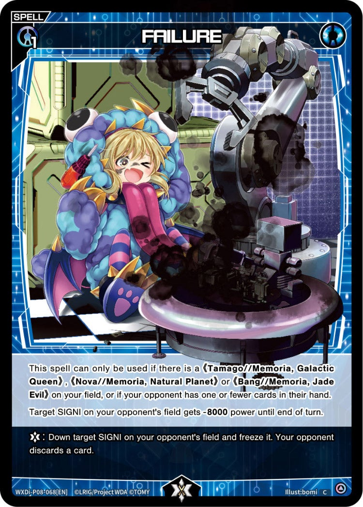

# FAILURE

## Thông tin lá

| Trường | Giá trị |
| --- | --- |
| Mã in | WXDi-P08-068[EN] |
| Set | WXDi-P08[EN] |
| Số thứ tự | 068 |
| Loại thẻ | SPELL |
| Vị trí | Main Deck |
| Số bản | — (set booster, không áp dụng) |
| Màu | Xanh dương |
| Độ hiếm | C,C(P) |
| Minh họa | bomi |
| Level | — |
| Limit | — |
| Power | 0 |
| LRIG type / Class | — |
| Team / Master | — |
| Cost | 《U》×１ |
| Grow cost | — |
| Use timing | — |
| Life Burst | Có |

## Card text chính thức

This spell can only be used if there is a 《Tamago//Memoria, Natural Planet Queen》, 《Nova//Memoria, Natural Planet》 or 《Bang//Memoria, Jade Evil》 on your field, or if your opponent has one or fewer cards in their hand.

Target SIGNI on your opponent's field gets -8000 power until end of turn.

## Power text / Life Burst

Down target SIGNI on your opponent's field and freeze it. Your opponent discards a card.

## Ghi chú minh họa
Artist: bomi. Ảnh C được tải từ Card List tiếng Anh.

## FAQ chính thức

— (không có FAQ riêng cho mã này trên trang FAQ tiếng Anh.)

## Ảnh biến thể

- [C(P)](../images/WXDi-P08-068P-EN.jpg)

## Nguồn
[Card List/FAQ chính thức](https://www.takaratomy.co.jp/products/en.wixoss/card/card.html?card_no=WXDi-P08-068%5BEN%5D ) · [Ảnh thẻ](https://www.takaratomy.co.jp/products/en.wixoss/card/thumb/WXDi-P08-068%5BEN%5D.jpg)
