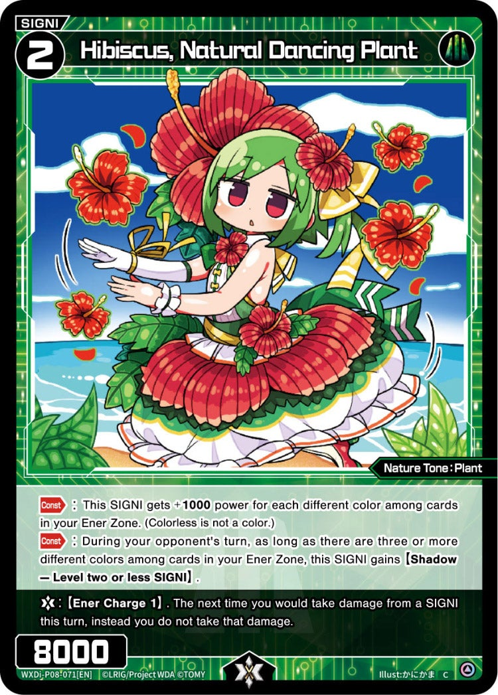

# Hibiscus, Natural Dancing Plant

## Thông tin lá

| Trường | Giá trị |
| --- | --- |
| Mã in | WXDi-P08-071[EN] |
| Set | WXDi-P08[EN] |
| Số thứ tự | 071 |
| Loại thẻ | SIGNI |
| Vị trí | Main Deck |
| Số bản | — (set booster, không áp dụng) |
| Màu | Xanh lá |
| Độ hiếm | C,C(P) |
| Minh họa | かにかま |
| Level | 2 |
| Limit | — |
| Power | 8000 |
| LRIG type / Class | Nature Tone：Plant |
| Team / Master | — |
| Cost | — |
| Grow cost | — |
| Use timing | — |
| Life Burst | Có |

## Card text chính thức

[Constant]: This SIGNI gets +1000 power for each different color among cards in your Ener Zone. (Colorless is not a color.)
[Constant]: During your opponent's turn, as long as there are three or more different colors among cards in your Ener Zone, this SIGNI gains 【Shadow — Level two or less SIGNI】.

## Power text / Life Burst

【Ener Charge 1】. The next time you would take damage from a SIGNI this turn, instead you do not take that damage.

## Ghi chú minh họa
Artist: かにかま. Ảnh C được tải từ Card List tiếng Anh.

## FAQ chính thức

**Q. Does this SIGNI get +5000 power if a card with the [Multi Ener] is in my Ener Zone?**
A. No, having a card with [Multi Ener] in your Ener Zone does not grant +5000 power to this SIGNI. [Multi Ener] simply allows you to pay for ener costs with it as if it were any one color, but it does not change the color of the card. For example, the card 《Servant #》 has [Multi Ener], but it is colorless and therefore cannot be counted as any color type.

**Q. If this SIGNI has 【Shadow - Level two or less SIGNI)】, is it still not targeted by the Life Burst effect of a Level two or less SIGNI?**
A. Yes, if the Life Burst is triggered by a Level two or less SIGNI, it is not targeted.

## Ảnh biến thể

- [C(P)](../images/WXDi-P08-071P-EN.jpg)

## Nguồn
[Card List/FAQ chính thức](https://www.takaratomy.co.jp/products/en.wixoss/card/card.html?card_no=WXDi-P08-071%5BEN%5D ) · [Ảnh thẻ](https://www.takaratomy.co.jp/products/en.wixoss/card/thumb/WXDi-P08-071%5BEN%5D.jpg)
