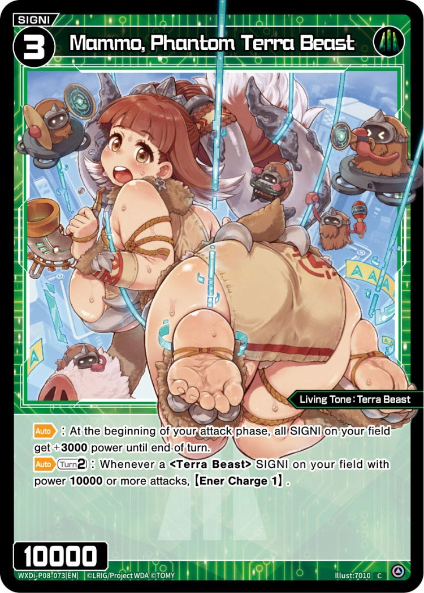

# Mammo, Phantom Terra Beast

## Thông tin lá

| Trường | Giá trị |
| --- | --- |
| Mã in | WXDi-P08-073[EN] |
| Set | WXDi-P08[EN] |
| Số thứ tự | 073 |
| Loại thẻ | SIGNI |
| Vị trí | Main Deck |
| Số bản | — (set booster, không áp dụng) |
| Màu | Xanh lá |
| Độ hiếm | C,C(P) |
| Minh họa | 7010 |
| Level | 3 |
| Limit | — |
| Power | 10000 |
| LRIG type / Class | Living Tone：Terra Beast |
| Team / Master | — |
| Cost | — |
| Grow cost | — |
| Use timing | — |
| Life Burst | Không |

## Card text chính thức

[Auto]: At the beginning of your attack phase, all SIGNI on your field get +3000 power until end of turn.
[Auto] {2/Turn}: Whenever a <Terra Beast> SIGNI on your field with power 10000 or more attacks, 【Ener Charge 1】.

## Power text / Life Burst

—

## Ghi chú minh họa
Artist: 7010. Ảnh C được tải từ Card List tiếng Anh.

## FAQ chính thức

**Q. Will the newly put a SIGNI get +3000 power if it is put after the first [Auto] ability has triggered during that attack phase?**
A. No, it will not. The first [Auto] ability only affects the SIGNI that is on your field at the time it is triggered.

## Ảnh biến thể

- [C(P)](../images/WXDi-P08-073P-EN.jpg)

## Nguồn
[Card List/FAQ chính thức](https://www.takaratomy.co.jp/products/en.wixoss/card/card.html?card_no=WXDi-P08-073%5BEN%5D ) · [Ảnh thẻ](https://www.takaratomy.co.jp/products/en.wixoss/card/thumb/WXDi-P08-073%5BEN%5D.jpg)
