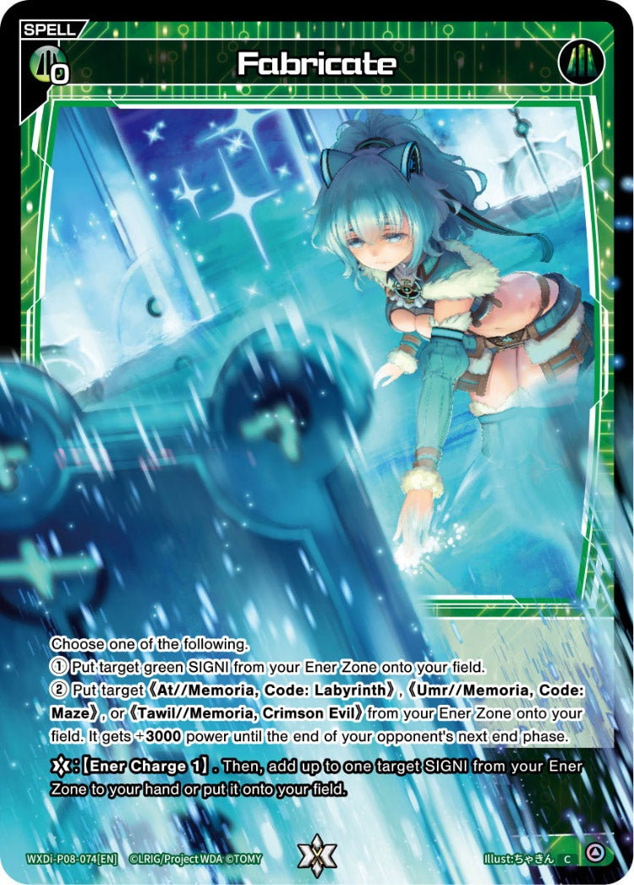

# Fabricate

## Thông tin lá

| Trường | Giá trị |
| --- | --- |
| Mã in | WXDi-P08-074[EN] |
| Set | WXDi-P08[EN] |
| Số thứ tự | 074 |
| Loại thẻ | SPELL |
| Vị trí | Main Deck |
| Số bản | — (set booster, không áp dụng) |
| Màu | Xanh lá |
| Độ hiếm | C,C(P) |
| Minh họa | ちゃきん |
| Level | — |
| Limit | — |
| Power | 0 |
| LRIG type / Class | — |
| Team / Master | — |
| Cost | 《G》×０ |
| Grow cost | — |
| Use timing | — |
| Life Burst | Có |

## Card text chính thức

Choose one of the following.
① Put target green SIGNI from your Ener Zone onto your field.
② Put target 《At//Memoria, Code: Labyrinth》, 《Umr//Memoria, Code: Maze》, or 《Tawil//Memoria, Crimson Evil》 from your Ener Zone onto your field. It gets +3000 power until the end of your opponent's next end phase.

## Power text / Life Burst

【Ener Charge 1】. Then, add up to one target SIGNI from your Ener Zone to your hand or put it onto your field.

## Ghi chú minh họa
Artist: ちゃきん. Ảnh C được tải từ Card List tiếng Anh.

## FAQ chính thức

— (không có FAQ riêng cho mã này trên trang FAQ tiếng Anh.)

## Ảnh biến thể

- [C(P)](../images/WXDi-P08-074P-EN.jpg)

## Nguồn
[Card List/FAQ chính thức](https://www.takaratomy.co.jp/products/en.wixoss/card/card.html?card_no=WXDi-P08-074%5BEN%5D ) · [Ảnh thẻ](https://www.takaratomy.co.jp/products/en.wixoss/card/thumb/WXDi-P08-074%5BEN%5D.jpg)
