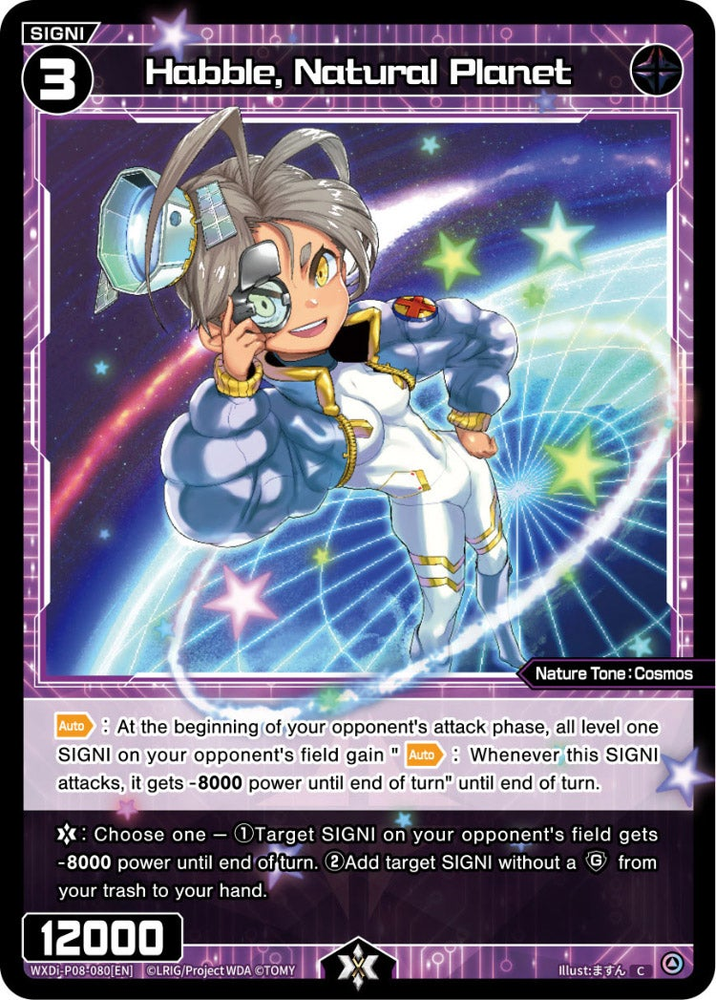

# Habble, Natural Planet

## Thông tin lá

| Trường | Giá trị |
| --- | --- |
| Mã in | WXDi-P08-080[EN] |
| Set | WXDi-P08[EN] |
| Số thứ tự | 080 |
| Loại thẻ | SIGNI |
| Vị trí | Main Deck |
| Số bản | — (set booster, không áp dụng) |
| Màu | Đen |
| Độ hiếm | C,C(P) |
| Minh họa | ますん |
| Level | 3 |
| Limit | — |
| Power | 12000 |
| LRIG type / Class | Nature Tone：Cosmos |
| Team / Master | — |
| Cost | — |
| Grow cost | — |
| Use timing | — |
| Life Burst | Có |

## Card text chính thức

[Auto]: At the beginning of your opponent's attack phase, all level one SIGNI on your opponent's field gain "[Auto]: Whenever this SIGNI attacks, it gets -8000 power until end of turn" until end of turn.

## Power text / Life Burst

Choose one — ①Target SIGNI on your opponent's field gets -8000 power until end of turn. ②Add target SIGNI without a {Guard Icon} from your trash to your hand.

## Ghi chú minh họa
Artist: ますん. Ảnh C được tải từ Card List tiếng Anh.

## FAQ chính thức

**Q. If a Level one SIGNI with [Auto] ability gained through 《Habble, Natural Planet》 attacks when there are no SIGNI in front of it, will damage be dealt?**
A. No, it does not deal damage. When it attacks, the [Auto] ability triggered at "Whenever this SIGNI attacks" is resolved before any battle with the front SIGNI or damage to the opponent. If the attacking SIGNI leaves the field as a result, no further processing will occur.

**Q. If there are two of this SIGNI on my field and we enter my opponent's attack phase, what happens to my opponent's Level one SIGNI with the [Atuo] abilities gained through the effects of the two SIGNI cards?**
A. Your opponent's Level one SIGNI gains the [Auto] abilities from two 《Habble, Natural Planet》 SIGNI on my field. When that SIGNI attacks, its power is reduced by a total of -16000 power.

## Ảnh biến thể

- [C(P)](../images/WXDi-P08-080P-EN.jpg)

## Nguồn
[Card List/FAQ chính thức](https://www.takaratomy.co.jp/products/en.wixoss/card/card.html?card_no=WXDi-P08-080%5BEN%5D ) · [Ảnh thẻ](https://www.takaratomy.co.jp/products/en.wixoss/card/thumb/WXDi-P08-080%5BEN%5D.jpg)
