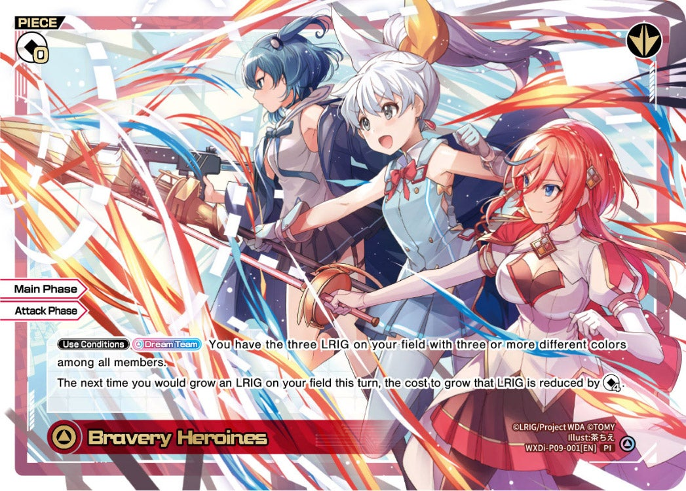

# Bravery Heroines

## Thông tin lá

| Trường | Giá trị |
| --- | --- |
| Mã in | WXDi-P09-001[EN] |
| Set | WXDi-P09[EN] |
| Số thứ tự | 001 |
| Loại thẻ | PIECE |
| Vị trí | LRIG Deck |
| Số bản | — (set booster, không áp dụng) |
| Màu | Đỏ |
| Độ hiếm | PI,LRP |
| Minh họa | 茶ちえ |
| Level | — |
| Limit | — |
| Power | 0 |
| LRIG type / Class | — |
| Team / Master | — |
| Cost | 《C》×０ |
| Grow cost | — |
| Use timing | Main Phase / Attack Phase |
| Life Burst | Không |

## Card text chính thức

[Use Conditions] [Dream Team] You have the three LRIG on your field with three or more different colors among all members.

The next time you would grow an LRIG on your field this turn, the cost to grow that LRIG is reduced by {Colorlessx4}.

## Power text / Life Burst

—

## Ghi chú minh họa
Artist: 茶ちえ. Ảnh PI được tải từ Card List tiếng Anh.

## FAQ chính thức

**Q. Does this effect of PIECE apply to the Assist LRIG's grow cost?**
A. Yes. For example, if you have 《Akino*Paper》 with a Grow Cost of 《{Colorless}*5》, you can reduce the Grow Cost by 《{Colorless}*4》 and grow it by 《{Colorless}*1》.

**Q. After using this PIECE, I grew a LRIG that does not have any colorless in its Grow Cost or a LRIG with a Grow Cost of zero. Is the effect of this PIECE still active?**
A. No, it is not. If there were no colorless in the cost or the cost was zero and it was not actually reduced, the effect of this PIECE does not apply to that growth. Furthermore, in the next growth, the Grow Cost is not reduced.

## Ảnh biến thể

- [LRP](../images/WXDi-P09-001P-EN.jpg)

## Nguồn
[Card List/FAQ chính thức](https://www.takaratomy.co.jp/products/en.wixoss/card/card.html?card_no=WXDi-P09-001%5BEN%5D ) · [Ảnh thẻ](https://www.takaratomy.co.jp/products/en.wixoss/card/thumb/WXDi-P09-001%5BEN%5D.jpg)
