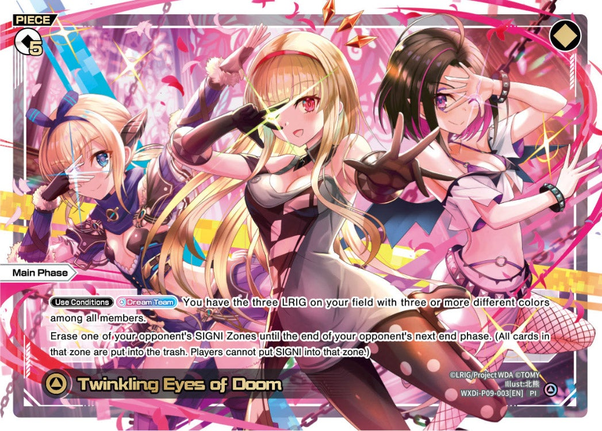

# Twinkling Eyes of Doom

## Thông tin lá

| Trường | Giá trị |
| --- | --- |
| Mã in | WXDi-P09-003[EN] |
| Set | WXDi-P09[EN] |
| Số thứ tự | 003 |
| Loại thẻ | PIECE |
| Vị trí | LRIG Deck |
| Số bản | — (set booster, không áp dụng) |
| Màu | Không màu |
| Độ hiếm | PI,LRP |
| Minh họa | 北熊 |
| Level | — |
| Limit | — |
| Power | 0 |
| LRIG type / Class | — |
| Team / Master | — |
| Cost | 《C》×５ |
| Grow cost | — |
| Use timing | Main Phase |
| Life Burst | Không |

## Card text chính thức

[Use Conditions] [Dream Team] You have the three LRIG on your field with three or more different colors among all members.

Erase one of your opponent's SIGNI Zones until the end of your opponent's next end phase. (All cards in that zone are put into the trash. Players cannot put SIGNI into that zone.)

## Power text / Life Burst

—

## Ghi chú minh họa
Artist: 北熊. Ảnh PI được tải từ Card List tiếng Anh.

## FAQ chính thức

**Q. What happens if I attack with a SIGNI that is in front of the SIGNI zone that was erased by the effect of this PIECE?**
A. Since there is no SIGNI in front of attacked SIGNI, attacked SIGNI will deal damage to your opponent.

**Q. If the right SIGNI zone is erased by this effect, does the center SIGNI zone cease to be treated as the "center"?**
A. No, even if the right SIGNI zone is erased, the other SIGNI zones are still treated as the left SIGNI zone and the center SIGNI zone. For example, the effect of 《Kaede Higuchi, Code 2434》 which adds power to SIGNI in the center SIGNI zone remains unchanged even after the right SIGNI zone is erased, and it still adds power to the SIGNI in the center SIGNI zone.

**Q. Does the card put in my opponent's trash by this PIECE's effect return to the field at the end of the turn?**
A. No, it doesn't.

**Q. What happens if there is 【Hastalyk】 or 【Virus】 in the SIGNI zone that is erased by this effect?**
A. Since they are placed in the SIGNI zone, when the SIGNI zone is erased, they are removed from the game.

**Q. If there is a SIGNI in the SIGNI zone that has abilities such as "leave the field" or "whenever a card is put into the trash" and that SIGNI zone is erased by this effect, do those abilities trigger?**
A. Yes, it is triggered.

## Ảnh biến thể

- [LRP](../images/WXDi-P09-003P-EN.jpg)

## Nguồn
[Card List/FAQ chính thức](https://www.takaratomy.co.jp/products/en.wixoss/card/card.html?card_no=WXDi-P09-003%5BEN%5D ) · [Ảnh thẻ](https://www.takaratomy.co.jp/products/en.wixoss/card/thumb/WXDi-P09-003%5BEN%5D.jpg)
