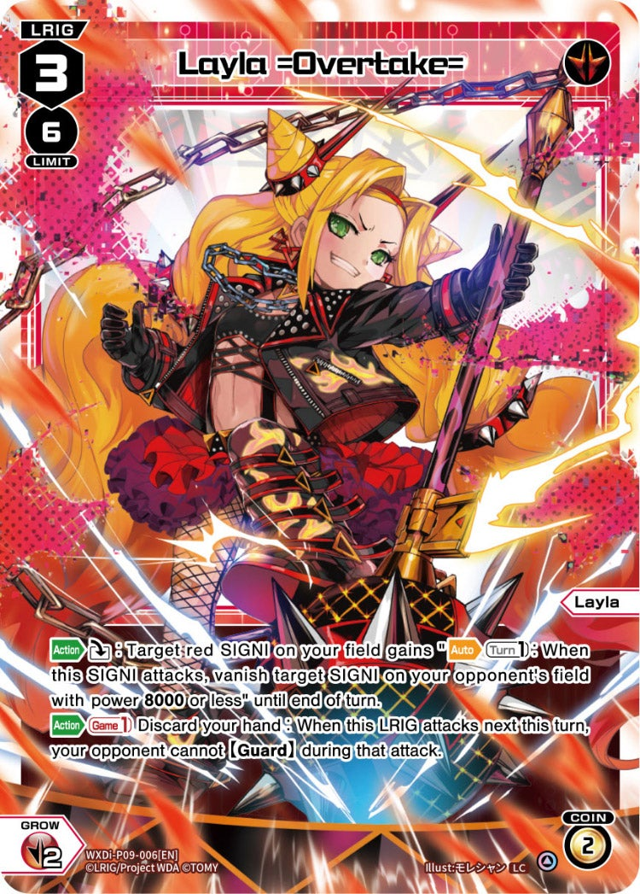

# Layla =Overtake=

## Thông tin lá

| Trường | Giá trị |
| --- | --- |
| Mã in | WXDi-P09-006[EN] |
| Set | WXDi-P09[EN] |
| Số thứ tự | 006 |
| Loại thẻ | LRIG |
| Vị trí | LRIG Deck |
| Số bản | — (set booster, không áp dụng) |
| Màu | Đỏ |
| Độ hiếm | LC,LR,LRP,UR |
| Minh họa | モレシャン |
| Level | 3 |
| Limit | 6 |
| Power | 0 |
| LRIG type / Class | Layla |
| Team / Master | — |
| Cost | — |
| Grow cost | 《R》×２ |
| Use timing | — |
| Life Burst | Không |

## Card text chính thức

[Action] {Down}: Target red SIGNI on your field gains "[Auto] {1/Turn}: When this SIGNI attacks, vanish target SIGNI on your opponent's field with power 8000 or less" until end of turn.
[Action] {1/Game} Discard your hand: When this LRIG attacks next this turn, your opponent cannot 【Guard】 during that attack.

## Power text / Life Burst

—

## Ghi chú minh họa
Artist: モレシャン. Ảnh LC được tải từ Card List tiếng Anh.

## FAQ chính thức

**Q. Will damage be dealt to my opponent when a SIGNI that gained ability through the first [Action] ability attacks and vanishes a front SIGNI with its [Auto] ability?**
A. Yes, damage will be dealt. If the [Auto] ability triggered during the attack resolves and as a result, there are no longer any SIGNI in the front, damage will be dealt to your opponent.

**Q. If I use the second [Action] ability and attack with this LRIG, then later, through some effect, this LRIG up and attacks again, may my opponent 【Guard】 against it?**
A. Yes, your opponent can 【Guard】. The effect of the second [Action] ability applies only to the next attack after using the ability.

## Ảnh biến thể

- [LRP](../images/WXDi-P09-006P-EN.jpg)
- [LR](../images/WXDi-P09-006R-EN.jpg)
- [UR](../images/WXDi-P09-006U-EN.jpg)

## Nguồn
[Card List/FAQ chính thức](https://www.takaratomy.co.jp/products/en.wixoss/card/card.html?card_no=WXDi-P09-006%5BEN%5D ) · [Ảnh thẻ](https://www.takaratomy.co.jp/products/en.wixoss/card/thumb/WXDi-P09-006%5BEN%5D.jpg)
