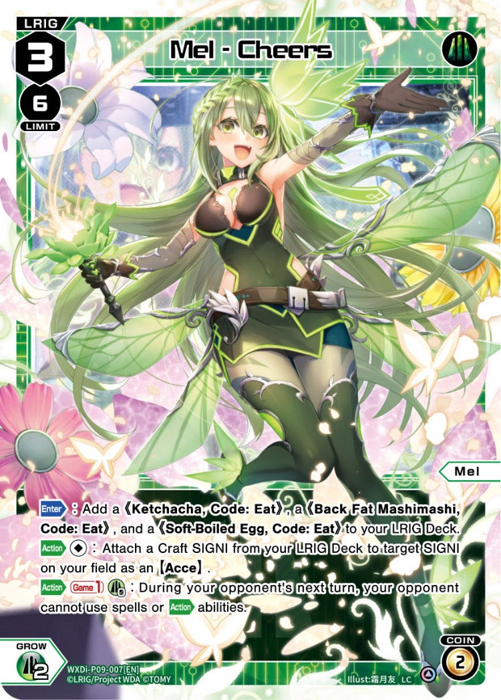

# Mel - Cheers

## Thông tin lá

| Trường | Giá trị |
| --- | --- |
| Mã in | WXDi-P09-007[EN] |
| Set | WXDi-P09[EN] |
| Số thứ tự | 007 |
| Loại thẻ | LRIG |
| Vị trí | LRIG Deck |
| Số bản | — (set booster, không áp dụng) |
| Màu | Xanh lá |
| Độ hiếm | LC,LR,LRP,UR |
| Minh họa | 霜月友 / Hitoto* |
| Level | 3 |
| Limit | 6 |
| Power | 0 |
| LRIG type / Class | Mel |
| Team / Master | — |
| Cost | — |
| Grow cost | 《G》×２ |
| Use timing | — |
| Life Burst | Không |

## Card text chính thức

[Enter]: Add a 《Ketchacha, Code: Eat》, a 《Back Fat Mashimashi, Code: Eat》, and a 《Soft-Boiled Egg, Code: Eat》 to your LRIG Deck.
[Action] {Colorless}: Attach a Craft SIGNI from your LRIG Deck to target SIGNI on your field as an 【Acce】.
[Action] {1/Game} {Greenx0}: During your opponent's next turn, your opponent cannot use spells or [Action] abilities.

## Power text / Life Burst

—

## Ghi chú minh họa
Artist: 霜月友 / Hitoto*. Ảnh LC được tải từ Card List tiếng Anh.

## FAQ chính thức

**Q. What are the 《Ketchacha, Code: Eat》,  《Back Fat Mashimashi, Code: Eat》, and 《Soft - Boiled Egg, Code: Eat》 that are added to the LRIG deck by this [Enter] ability?**
A. These are CRAFT SIGNI used for the effect of 《Mel - Cheers》 Initially, they cannot be included in the deck and can only be added to the LRIG deck by resolving the [Enter] ability's effect. These CRAFT SIGNI cannot be normally put onto the field through regular means but can be attached to SIGNI on the field as 【Acce】 through the effect of 《Mel - Cheers》.

**Q. What is 【Acce】?**
A. You can attach up to one 【Acce】 to your SIGNI using the effect of "as an 【Acce】" You cannot attach 【Acce】 to a SIGNI that already has 【Acce】, nor can you replace an existing 【Acce】. A SIGNI with 【Acce】 gains various effects. If the SIGNI with 【Acce】 leaves the field or is placed underneath another SIGNI, such as through a 【Rise】 effect, the attached 【Acce】 is put into the trash as a Rule-based action. If the attached 【Acce】 is a CRAFT SIGNI, it is removed from the game.

**Q. If I add three CRAFT SIGNI to the LRIG deck through the [Enter] ability, do I have to reduce the deck size from ten cards to seven cards when building the LRIG deck?**
A. No, these three cards are not counted towards the original deck size. The LRIG deck will consist of twelve cards, including the two PIECE, but this is a restriction during deck construction, and it is not a problem if the number of cards in the LRIG deck increases during the game due to effects.

## Ảnh biến thể

- [LRP](../images/WXDi-P09-007P-EN.jpg)
- [LR](../images/WXDi-P09-007R-EN.jpg)
- [UR](../images/WXDi-P09-007U-EN.jpg)

## Nguồn
[Card List/FAQ chính thức](https://www.takaratomy.co.jp/products/en.wixoss/card/card.html?card_no=WXDi-P09-007%5BEN%5D ) · [Ảnh thẻ](https://www.takaratomy.co.jp/products/en.wixoss/card/thumb/WXDi-P09-007%5BEN%5D.jpg)
