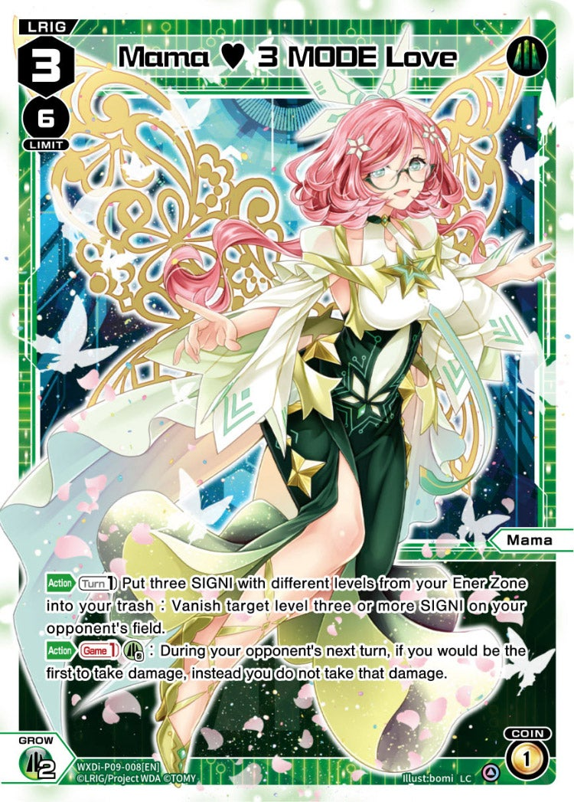

# Mama ♥ 3 MODE Love

## Thông tin lá

| Trường | Giá trị |
| --- | --- |
| Mã in | WXDi-P09-008[EN] |
| Set | WXDi-P09[EN] |
| Số thứ tự | 008 |
| Loại thẻ | LRIG |
| Vị trí | LRIG Deck |
| Số bản | — (set booster, không áp dụng) |
| Màu | Xanh lá |
| Độ hiếm | LC,LR,LRP,UR |
| Minh họa | bomi
よん |
| Level | 3 |
| Limit | 6 |
| Power | 0 |
| LRIG type / Class | Mama |
| Team / Master | — |
| Cost | — |
| Grow cost | 《G》×２ |
| Use timing | 1 |
| Life Burst | Không |

## Card text chính thức

[Action] {1/Turn} Put three SIGNI with different levels from your Ener Zone into your trash: Vanish target level three or more SIGNI on your opponent's field.
[Action] {1/Game} {Greenx0}: During your opponent's next turn, if you would be the first to take damage, instead you do not take that damage.

## Power text / Life Burst

—

## Ghi chú minh họa
Artist: bomi
よん. Ảnh LC được tải từ Card List tiếng Anh.

## FAQ chính thức

**Q. May I put cards from my opponent's Ener Zone into its owner's trash as a cost for the first [Action] ability?**
A. No, you can only put cards from your Ener Zone as a cost.

**Q. If a SIGNI with [Double Crush] from your opponent attacks and deals damage after using the second [Action] ability, what happens?**
A. Life Cloth is not crushed at all. [Double Crush] is an ability that allows two cards to be crushed when dealing damage through an attack, but this effect prevents the damage itself from being inflicted in the first place.

## Ảnh biến thể

- [LRP](../images/WXDi-P09-008P-EN.jpg)
- [LR](../images/WXDi-P09-008R-EN.jpg)
- [UR](../images/WXDi-P09-008U-EN.jpg)

## Nguồn
[Card List/FAQ chính thức](https://www.takaratomy.co.jp/products/en.wixoss/card/card.html?card_no=WXDi-P09-008%5BEN%5D ) · [Ảnh thẻ](https://www.takaratomy.co.jp/products/en.wixoss/card/thumb/WXDi-P09-008%5BEN%5D.jpg)
