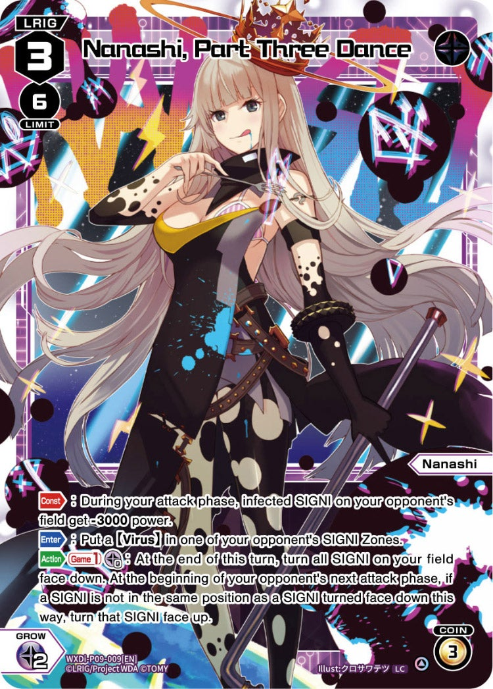

# Nanashi, Part Three Dance

## Thông tin lá

| Trường | Giá trị |
| --- | --- |
| Mã in | WXDi-P09-009[EN] |
| Set | WXDi-P09[EN] |
| Số thứ tự | 009 |
| Loại thẻ | LRIG |
| Vị trí | LRIG Deck |
| Số bản | — (set booster, không áp dụng) |
| Màu | Đen |
| Độ hiếm | LC,LR,LRP,UR |
| Minh họa | クロサワテツ |
| Level | 3 |
| Limit | 6 |
| Power | 0 |
| LRIG type / Class | Nanashi |
| Team / Master | — |
| Cost | — |
| Grow cost | 《B》×２ |
| Use timing | — |
| Life Burst | Không |

## Card text chính thức

[Constant]: During your attack phase, infected SIGNI on your opponent's field get -3000 power.
[Enter]: Put a 【Virus】 in one of your opponent's SIGNI Zones.
[Action] {1/Game} {Blackx0}: At the end of this turn, turn all SIGNI on your field face down. At the beginning of your opponent's next attack phase, if a SIGNI is not in the same position as a SIGNI turned face down this way, turn that SIGNI face up.

## Power text / Life Burst

—

## Ghi chú minh họa
Artist: クロサワテツ. Ảnh LC được tải từ Card List tiếng Anh.

## FAQ chính thức

**Q. What is 【Virus】**
A. A card effect may put 【Virus】 on the SIGNI Zone. You can put up to one 【Virus】 per SIGNI Zone. The SIGNI in the same Signi Zone as 【Virus】 become infected. Nothing happens just by being infected, but the effect may refer to the infected state.

**Q. What happens when a SIGNI has cards attached to it or cards placed underneath it when it is turned face down by this [Action] ability?**
A. Cards such as [Soul] or [Acce] can only be attached to SIGNI, so when the SIGNI is turned face down, those attached cards will be put into the trash via a rule-based action. Cards placed underneath the SIGNI will remain in their current position, continuing to be placed underneath the face down card (they will remain face up).

**Q. If I used this [Action] ability to turn one of my SIGNI face down, and at the beginning of the next my opponent's Attack Phase, I put another SIGNI on the same SIGNI zone as the face down card, what happens to the face down card?**
A. In that case, the card cannot be turned face up and will remain face down until the end of the game.

**Q. What happens to a SIGNI on the field when it is turned face down?**
A. It becomes just a face down card on the field and is not treated as a SIGNI. It is possible to put another SIGNI in the same SIGNI zone as the face down card.

**Q. If I used this [Action] ability to turn one of my SIGNI face down, and my opponent has an [Auto] ability triggered "At the beginning of your attack phase" what happens?**
A. If both players have abilities triggered "at the beginning of the attack phase" both of them will trigger, starting with the turn player's abilities. In this case, after the [Auto] ability of the non-turn player (your opponent) has resolved, you can use 《Nanashi, Part Three Dance》 to turn your SIGNI face up.

## Ảnh biến thể

- [LRP](../images/WXDi-P09-009P-EN.jpg)
- [LR](../images/WXDi-P09-009R-EN.jpg)
- [UR](../images/WXDi-P09-009U-EN.jpg)

## Nguồn
[Card List/FAQ chính thức](https://www.takaratomy.co.jp/products/en.wixoss/card/card.html?card_no=WXDi-P09-009%5BEN%5D ) · [Ảnh thẻ](https://www.takaratomy.co.jp/products/en.wixoss/card/thumb/WXDi-P09-009%5BEN%5D.jpg)
