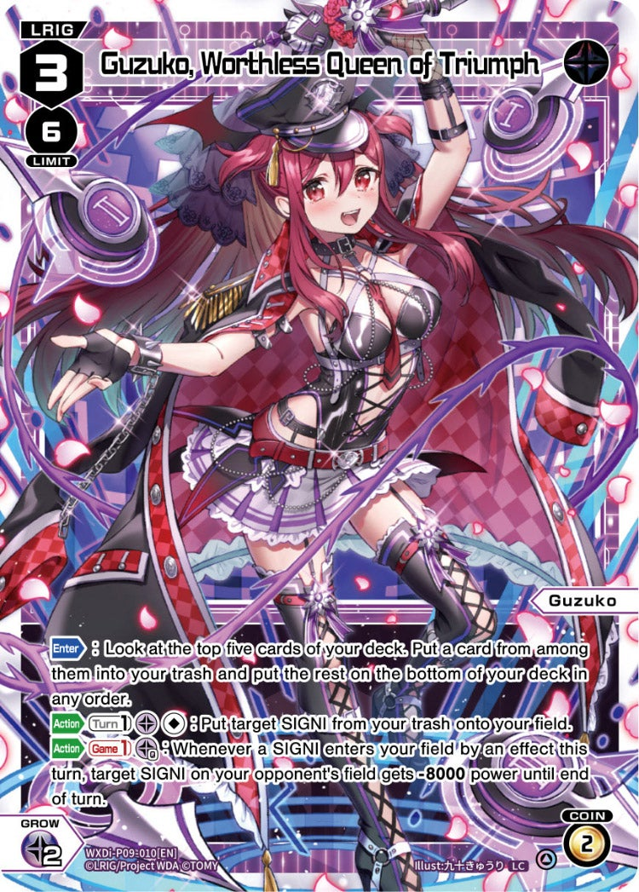

# Guzuko, Worthless Queen of Triumph

## Thông tin lá

| Trường | Giá trị |
| --- | --- |
| Mã in | WXDi-P09-010[EN] |
| Set | WXDi-P09[EN] |
| Số thứ tự | 010 |
| Loại thẻ | LRIG |
| Vị trí | LRIG Deck |
| Số bản | — (set booster, không áp dụng) |
| Màu | Đen |
| Độ hiếm | LC,LR,LRP,UR |
| Minh họa | 九十きゅうり
村上ゆいち |
| Level | 3 |
| Limit | 6 |
| Power | 0 |
| LRIG type / Class | Guzuko |
| Team / Master | — |
| Cost | — |
| Grow cost | 《B》×２ |
| Use timing | 2 |
| Life Burst | Không |

## Card text chính thức

[Enter]: Look at the top five cards of your deck. Put a card from among them into your trash and put the rest on the bottom of your deck in any order.
[Action] {1/Turn} {Black} {Colorless}: Put target SIGNI from your trash onto your field.
[Action] {1/Game} {Blackx0}: Whenever a SIGNI enters your field by an effect this turn, target SIGNI on your opponent's field gets -8000 power until end of turn.

## Power text / Life Burst

—

## Ghi chú minh họa
Artist: 九十きゅうり
村上ゆいち. Ảnh LC được tải từ Card List tiếng Anh.

## FAQ chính thức

**Q. Does the [Enter] ability have to be triggerd?**
A. Yes, the [Enter] ability without cost is must triggered.

**Q. May I directly put the card that I paid as the Ener cost for the first [Action] ability on the field with this ability?**
A. Yes, it is possible. After paying the Ener cost, you can choose a SIGNI from your trash to put on the field.

## Ảnh biến thể

- [LRP](../images/WXDi-P09-010P-EN.jpg)
- [LR](../images/WXDi-P09-010R-EN.jpg)
- [UR](../images/WXDi-P09-010U-EN.jpg)

## Nguồn
[Card List/FAQ chính thức](https://www.takaratomy.co.jp/products/en.wixoss/card/card.html?card_no=WXDi-P09-010%5BEN%5D ) · [Ảnh thẻ](https://www.takaratomy.co.jp/products/en.wixoss/card/thumb/WXDi-P09-010%5BEN%5D.jpg)
