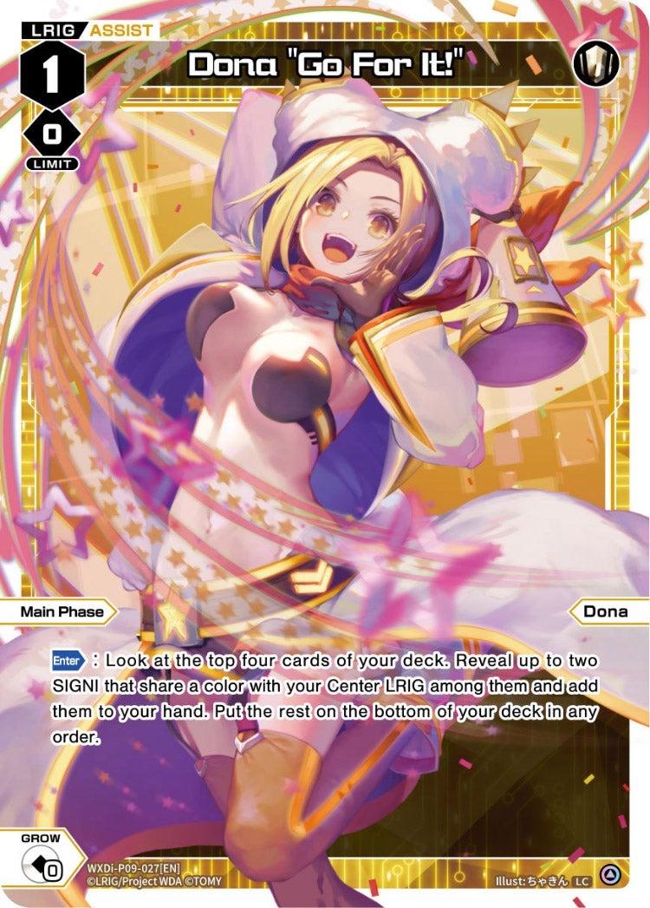

# Dona "Go For It!"

## Thông tin lá

| Trường | Giá trị |
| --- | --- |
| Mã in | WXDi-P09-027[EN] |
| Set | WXDi-P09[EN] |
| Số thứ tự | 027 |
| Loại thẻ | ASSIST LRIG |
| Vị trí | LRIG Deck |
| Số bản | — (set booster, không áp dụng) |
| Màu | Trắng |
| Độ hiếm | LC,LC(P) |
| Minh họa | ちゃきん |
| Level | 1 |
| Limit | 0 |
| Power | 0 |
| LRIG type / Class | Dona |
| Team / Master | — |
| Cost | — |
| Grow cost | 《C》×０ |
| Use timing | Main Phase |
| Life Burst | Không |

## Card text chính thức

[Enter]: Look at the top four cards of your deck. Reveal up to two SIGNI that share a color with your Center LRIG among them and add them to your hand. Put the rest on the bottom of your deck in any order.

## Power text / Life Burst

—

## Ghi chú minh họa
Artist: ちゃきん. Ảnh LC được tải từ Card List tiếng Anh.

## FAQ chính thức

**Q. When I use this [Enter] ability, if my center LRIG is red, may the card 《Percival, Blessed Crimson General》 which is both red and white, be added to my hand?**
A. Yes, it is possible. In the case of SIGNI with multiple colors, if it shares at least one color with the center LRIG, it can be added to the hand.

## Ảnh biến thể

- [LC(P)](../images/WXDi-P09-027P-EN.jpg)

## Nguồn
[Card List/FAQ chính thức](https://www.takaratomy.co.jp/products/en.wixoss/card/card.html?card_no=WXDi-P09-027%5BEN%5D ) · [Ảnh thẻ](https://www.takaratomy.co.jp/products/en.wixoss/card/thumb/WXDi-P09-027%5BEN%5D.jpg)
