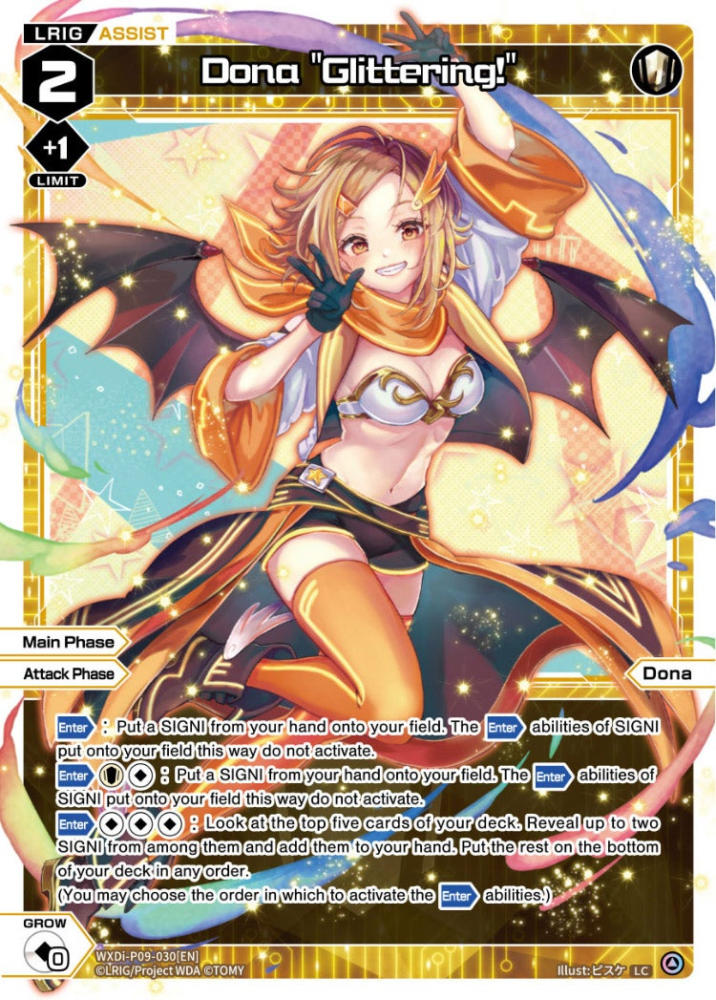

# Dona "Glittering!"

## Thông tin lá

| Trường | Giá trị |
| --- | --- |
| Mã in | WXDi-P09-030[EN] |
| Set | WXDi-P09[EN] |
| Số thứ tự | 030 |
| Loại thẻ | ASSIST LRIG |
| Vị trí | LRIG Deck |
| Số bản | — (set booster, không áp dụng) |
| Màu | Trắng |
| Độ hiếm | LC,LC(P) |
| Minh họa | ピスケ |
| Level | 2 |
| Limit | ＋１ |
| Power | 0 |
| LRIG type / Class | Dona |
| Team / Master | — |
| Cost | — |
| Grow cost | 《C》×０ |
| Use timing | Main Phase / Attack Phase |
| Life Burst | Không |

## Card text chính thức

[Enter]: Put a SIGNI from your hand onto your field. The [Enter] abilities of SIGNI put onto your field this way do not activate.
[Enter] {White} {Colorless}: Put a SIGNI from your hand onto your field. The [Enter] abilities of SIGNI put onto your field this way do not activate.
[Enter] {Colorless} {Colorless} {Colorless}: Look at the top five cards of your deck. Reveal up to two SIGNI from among them and add them to your hand. Put the rest on the bottom of your deck in any order.
(You may choose the order in which to activate the [Enter] abilities.)

## Power text / Life Burst

—

## Ghi chú minh họa
Artist: ピスケ. Ảnh LC được tải từ Card List tiếng Anh.

## FAQ chính thức

**Q. May I trigger the third [Enter] ability, add a SIGNI to my hand through its effect, and then put it on the field with the first or second [Enter] ability?**
A. Yes, you can.

**Q. Does the first [Enter] ability have to be triggered?**
A. Yes, the [Enter] ability without cost is must triggered. However, it must trigger, in the case of this ability, you can choose not to put the SIGNI on the field even if you have a SIGNI in your hand.

## Ảnh biến thể

- [LC(P)](../images/WXDi-P09-030P-EN.jpg)

## Nguồn
[Card List/FAQ chính thức](https://www.takaratomy.co.jp/products/en.wixoss/card/card.html?card_no=WXDi-P09-030%5BEN%5D ) · [Ảnh thẻ](https://www.takaratomy.co.jp/products/en.wixoss/card/thumb/WXDi-P09-030%5BEN%5D.jpg)
