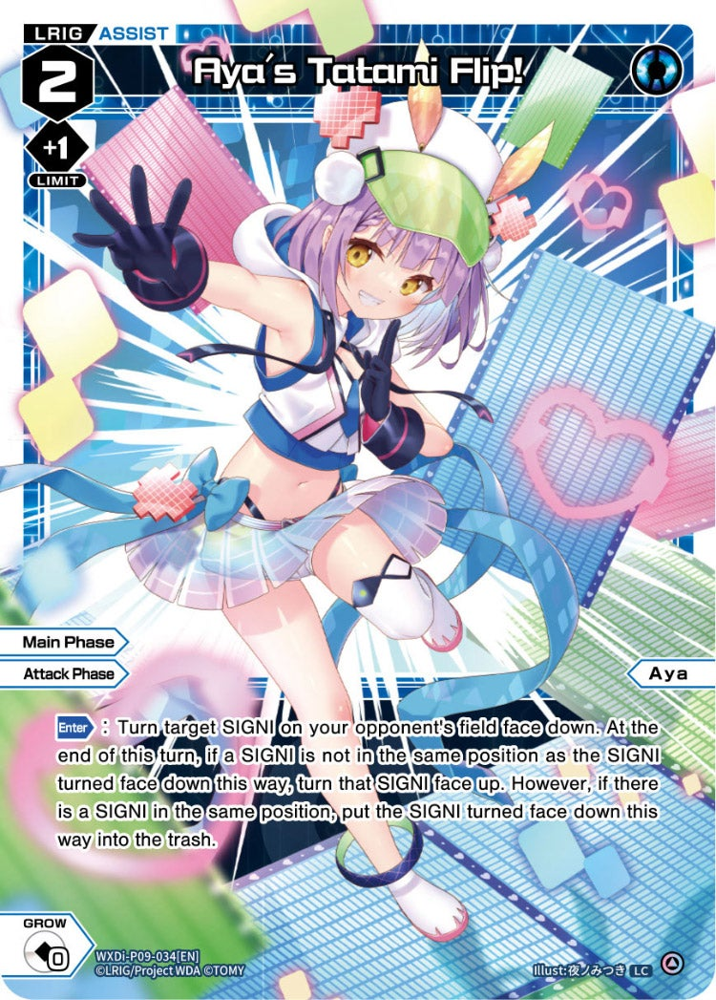

# Aya's Tatami Flip!

## Thông tin lá

| Trường | Giá trị |
| --- | --- |
| Mã in | WXDi-P09-034[EN] |
| Set | WXDi-P09[EN] |
| Số thứ tự | 034 |
| Loại thẻ | ASSIST LRIG |
| Vị trí | LRIG Deck |
| Số bản | — (set booster, không áp dụng) |
| Màu | Xanh dương |
| Độ hiếm | LC,LC(P) |
| Minh họa | 夜ノみつき |
| Level | 2 |
| Limit | ＋１ |
| Power | 0 |
| LRIG type / Class | Aya |
| Team / Master | — |
| Cost | — |
| Grow cost | 《C》×０ |
| Use timing | Main Phase
Attack Phase |
| Life Burst | Không |

## Card text chính thức

[Enter]: Turn target SIGNI on your opponent's field face down. At the end of this turn, if a SIGNI is not in the same position as the SIGNI turned face down this way, turn that SIGNI face up. However, if there is a SIGNI in the same position, put the SIGNI turned face down this way into the trash.

## Power text / Life Burst

—

## Ghi chú minh họa
Artist: 夜ノみつき. Ảnh LC được tải từ Card List tiếng Anh.

## FAQ chính thức

**Q. What happens to a SIGNI on the field when it is turned face down?**
A. It becomes just a face down card on the field and is not treated as a SIGNI. It is possible to put another SIGNI in the same SIGNI zone as the face down card.

**Q. What happens to the cards attached to or placed underneath my opponent's SIGNI when it is turned face down?**
A. Cards such as [Soul] or [Acce] can only be attached to SIGNI, so when the SIGNI is turned face down, those attached cards will be put into the trash via a rule-based action. Cards placed underneath the SIGNI will remain in their current position, continuing to be placed underneath the face down card (they will remain face up).

## Ảnh biến thể

- [LC(P)](../images/WXDi-P09-034P-EN.jpg)

## Nguồn
[Card List/FAQ chính thức](https://www.takaratomy.co.jp/products/en.wixoss/card/card.html?card_no=WXDi-P09-034%5BEN%5D ) · [Ảnh thẻ](https://www.takaratomy.co.jp/products/en.wixoss/card/thumb/WXDi-P09-034%5BEN%5D.jpg)
