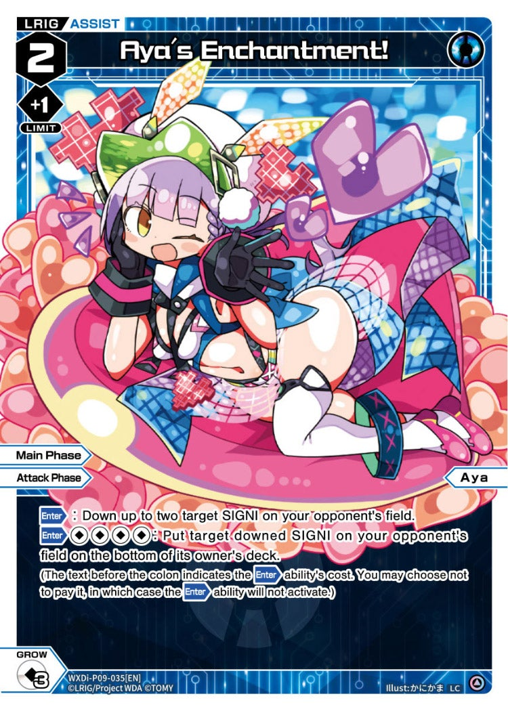

# Aya's Enchantment!

## Thông tin lá

| Trường | Giá trị |
| --- | --- |
| Mã in | WXDi-P09-035[EN] |
| Set | WXDi-P09[EN] |
| Số thứ tự | 035 |
| Loại thẻ | ASSIST LRIG |
| Vị trí | LRIG Deck |
| Số bản | — (set booster, không áp dụng) |
| Màu | Xanh dương |
| Độ hiếm | LC,LC(P) |
| Minh họa | かにかま |
| Level | 2 |
| Limit | ＋１ |
| Power | 0 |
| LRIG type / Class | Aya |
| Team / Master | — |
| Cost | — |
| Grow cost | 《C》×３ |
| Use timing | Main Phase
Attack Phase |
| Life Burst | Không |

## Card text chính thức

[Enter]: Down up to two target SIGNI on your opponent's field.
[Enter] {Colorless} {Colorless} {Colorless} {Colorless}: Put target downed SIGNI on your opponent's field on the bottom of its owner's deck.
(The text before the colon indicates the [Enter] ability's cost. You may choose not to pay it, in which case the [Enter] ability will not activate.)

## Power text / Life Burst

—

## Ghi chú minh họa
Artist: かにかま. Ảnh LC được tải từ Card List tiếng Anh.

## FAQ chính thức

**Q. May I target the SIGNI that was downed by resolving the first [Enter] ability and then triggered to be targeted by the second [Enter] ability?**
A. Yes, you can. [Enter] abilities can be triggered in any order, and when that ability is triggered, you choose its target.

## Ảnh biến thể

- [LC(P)](../images/WXDi-P09-035P-EN.jpg)

## Nguồn
[Card List/FAQ chính thức](https://www.takaratomy.co.jp/products/en.wixoss/card/card.html?card_no=WXDi-P09-035%5BEN%5D ) · [Ảnh thẻ](https://www.takaratomy.co.jp/products/en.wixoss/card/thumb/WXDi-P09-035%5BEN%5D.jpg)
