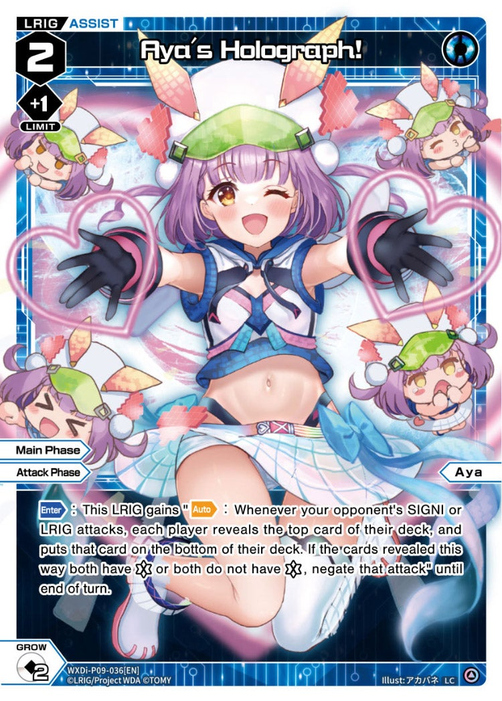

# Aya's Holograph!

## Thông tin lá

| Trường | Giá trị |
| --- | --- |
| Mã in | WXDi-P09-036[EN] |
| Set | WXDi-P09[EN] |
| Số thứ tự | 036 |
| Loại thẻ | ASSIST LRIG |
| Vị trí | LRIG Deck |
| Số bản | — (set booster, không áp dụng) |
| Màu | Xanh dương |
| Độ hiếm | LC,LC(P) |
| Minh họa | アカバネ |
| Level | 2 |
| Limit | ＋１ |
| Power | 0 |
| LRIG type / Class | Aya |
| Team / Master | — |
| Cost | — |
| Grow cost | 《C》×２ |
| Use timing | Main Phase / Attack Phase |
| Life Burst | Không |

## Card text chính thức

[Enter]: This LRIG gains "[Auto]: Whenever your opponent's SIGNI or LRIG attacks, each player reveals the top card of their deck, and puts that card on the bottom of their deck. If the cards revealed this way both have 【Life Burst】 or both do not have 【Life Burst】, negate that attack" until end of turn.

## Power text / Life Burst

—

## Ghi chú minh họa
Artist: アカバネ. Ảnh LC được tải từ Card List tiếng Anh.

## FAQ chính thức

**Q. What happens to the cards that were revealed by the [Auto] ability?**
A. After they are revealed and confirmed by both players, the cards are put face-down on the top of each player's deck.

**Q. Does this [Auto] ability trigger every time my opponent's SIGNI or LRIG attacks?**
A. Yes, it triggers every time a SIGNI or LRIG attacks.

## Ảnh biến thể

- [LC(P)](../images/WXDi-P09-036P-EN.jpg)

## Nguồn
[Card List/FAQ chính thức](https://www.takaratomy.co.jp/products/en.wixoss/card/card.html?card_no=WXDi-P09-036%5BEN%5D ) · [Ảnh thẻ](https://www.takaratomy.co.jp/products/en.wixoss/card/thumb/WXDi-P09-036%5BEN%5D.jpg)
