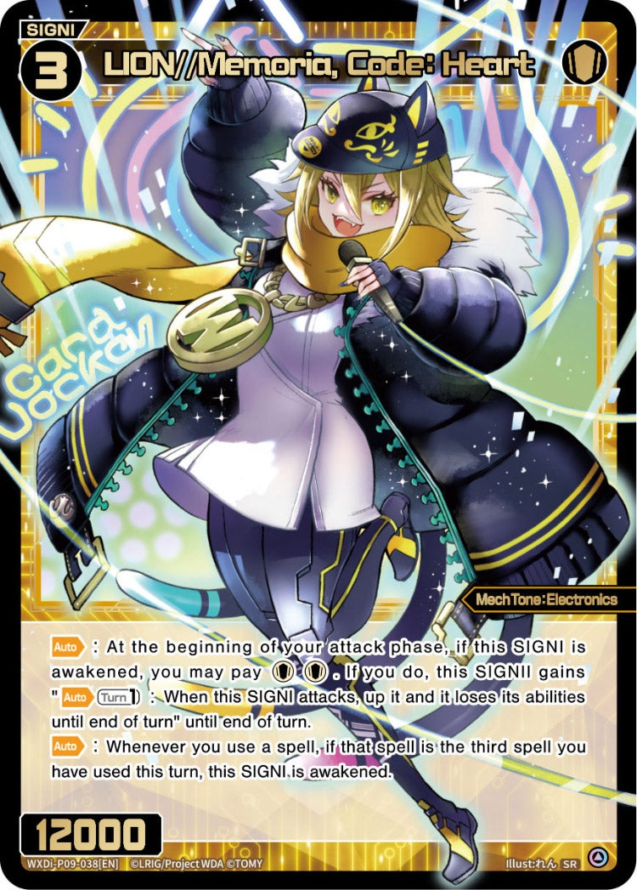

# LION//Memoria, Code: Heart

## Thông tin lá

| Trường | Giá trị |
| --- | --- |
| Mã in | WXDi-P09-038[EN] |
| Set | WXDi-P09[EN] |
| Số thứ tự | 038 |
| Loại thẻ | SIGNI |
| Vị trí | Main Deck |
| Số bản | — (set booster, không áp dụng) |
| Màu | Trắng |
| Độ hiếm | SR,SRP |
| Minh họa | れん |
| Level | 3 |
| Limit | — |
| Power | 12000 |
| LRIG type / Class | Mech Tone：Electronics |
| Team / Master | — |
| Cost | — |
| Grow cost | — |
| Use timing | — |
| Life Burst | Không |

## Card text chính thức

[Auto]: At the beginning of your attack phase, if this SIGNI is awakened, you may pay {White} {White}. If you do, this SIGNI gains "[Auto] {1/Turn}: When this SIGNI attacks, up it and it loses its abilities until end of turn" until end of turn.
[Auto]: Whenever you use a spell, if that spell is the third spell you have used this turn, this SIGNI is awakened.

## Power text / Life Burst

—

## Ghi chú minh họa
Artist: れん. Ảnh SR được tải từ Card List tiếng Anh.

## FAQ chính thức

**Q. Does the second [Auto] ability trigger after using two spells, and put this SIGNI on the field and using one more spell in the same turn?**
A. Yes, it triggers. It counts how many spells you have used in this turn, regardless of whether 《LION//Memoria, Code: Heart》 is on the field or not.

**Q. Is this SIGNI still in the awakened even after triggering its [Auto] ability upon attacking and losing its ability?**
A. Yes, even after losing its ability, it remains in the awakened state without any change to its status.

## Ảnh biến thể

- [SRP](../images/WXDi-P09-038P-EN.jpg)

## Nguồn
[Card List/FAQ chính thức](https://www.takaratomy.co.jp/products/en.wixoss/card/card.html?card_no=WXDi-P09-038%5BEN%5D ) · [Ảnh thẻ](https://www.takaratomy.co.jp/products/en.wixoss/card/thumb/WXDi-P09-038%5BEN%5D.jpg)
