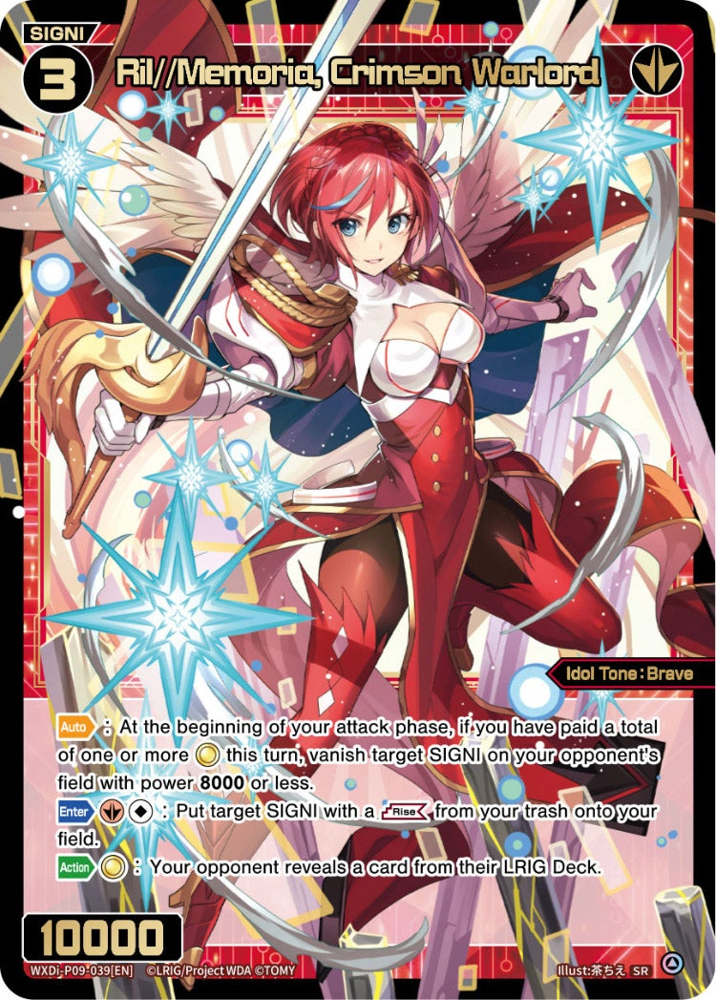

# Ril//Memoria, Crimson Warlord

## Thông tin lá

| Trường | Giá trị |
| --- | --- |
| Mã in | WXDi-P09-039[EN] |
| Set | WXDi-P09[EN] |
| Số thứ tự | 039 |
| Loại thẻ | SIGNI |
| Vị trí | Main Deck |
| Số bản | — (set booster, không áp dụng) |
| Màu | Đỏ |
| Độ hiếm | SR,SRP |
| Minh họa | 茶ちえ |
| Level | 3 |
| Limit | — |
| Power | 10000 |
| LRIG type / Class | Idol Tone：Brave |
| Team / Master | — |
| Cost | — |
| Grow cost | — |
| Use timing | — |
| Life Burst | Không |

## Card text chính thức

[Auto]: At the beginning of your attack phase, if you have paid a total of one or more {Coin Icon} this turn, vanish target SIGNI on your opponent's field with power 8000 or less.
[Enter] {Red} {Colorless}: Put target SIGNI with a {Rise Icon} from your trash onto your field.
[Action] {Coin Icon}: Your opponent reveals a card from their LRIG Deck.

## Power text / Life Burst

—

## Ghi chú minh họa
Artist: 茶ちえ. Ảnh SR được tải từ Card List tiếng Anh.

## FAQ chính thức

**Q. May I put a SIGNI with [Rise] on top of 《Ril//Memoria, Crimson Warlord》 using its [Enter] ability?**
A. Yes, it is possible if it fulfills the conditions for [Rise].

**Q. Even if I paid coins using abilities other than this SIGNI, does it still satisfy the conditions of the [Auto] ability?**
A. Yes, it meets the conditions. It doesn't matter if you paid the coins through abilities other than this SIGNI's ability.

**Q. Who chooses the card to reveal in the [Action] ability?**
A. The opponent of the player controlling 《Ril//Memoria, Crimson Warlord》 chooses one card from their own LRIG deck and reveals it.

## Ảnh biến thể

- [SRP](../images/WXDi-P09-039P-EN.jpg)

## Nguồn
[Card List/FAQ chính thức](https://www.takaratomy.co.jp/products/en.wixoss/card/card.html?card_no=WXDi-P09-039%5BEN%5D ) · [Ảnh thẻ](https://www.takaratomy.co.jp/products/en.wixoss/card/thumb/WXDi-P09-039%5BEN%5D.jpg)
