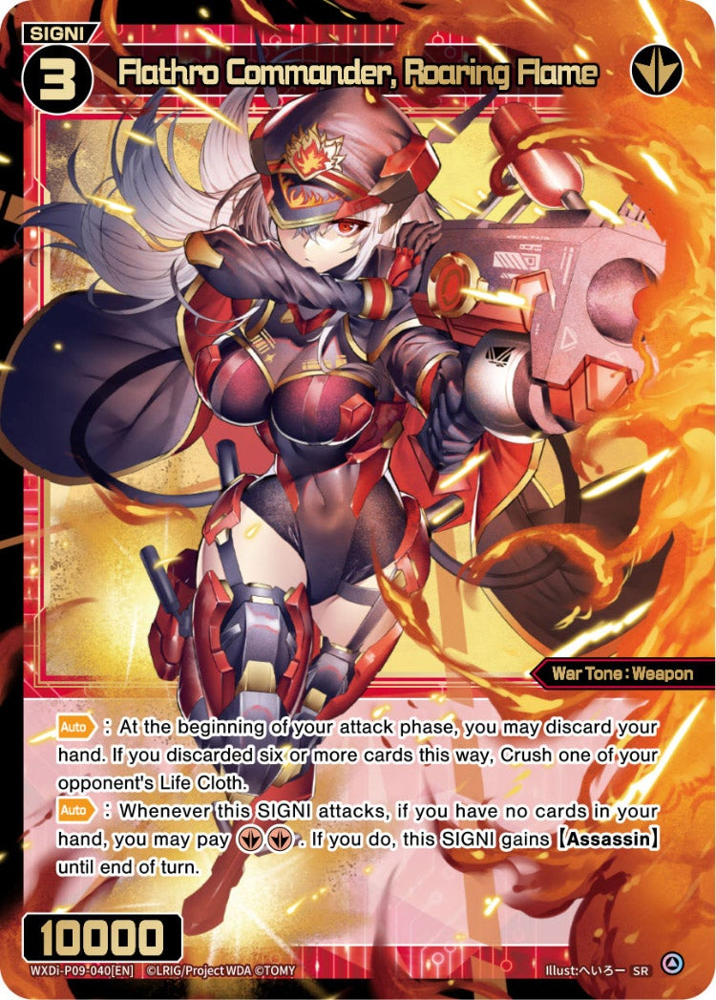

# Flathro Commander, Roaring Flame

## Thông tin lá

| Trường | Giá trị |
| --- | --- |
| Mã in | WXDi-P09-040[EN] |
| Set | WXDi-P09[EN] |
| Số thứ tự | 040 |
| Loại thẻ | SIGNI |
| Vị trí | Main Deck |
| Số bản | — (set booster, không áp dụng) |
| Màu | Đỏ |
| Độ hiếm | SR,SRP |
| Minh họa | へいろー |
| Level | 3 |
| Limit | — |
| Power | 10000 |
| LRIG type / Class | War Tone：Weapon |
| Team / Master | — |
| Cost | — |
| Grow cost | — |
| Use timing | — |
| Life Burst | Không |

## Card text chính thức

[Auto]: At the beginning of your attack phase, you may discard your hand. If you discarded six or more cards this way, Crush one of your opponent's Life Cloth.
[Auto]: Whenever this SIGNI attacks, if you have no cards in your hand, you may pay {Red} {Red}. If you do, this SIGNI gains 【Assassin】 until end of turn.

## Power text / Life Burst

—

## Ghi chú minh họa
Artist: へいろー. Ảnh SR được tải từ Card List tiếng Anh.

## FAQ chính thức

**Q. At the beginning of my attack phase, I discarded three cards from my hand with the first [Auto] ability. If I discard three cards from my hand again with the same first [Auto] ability on the next turn, may I crush one of my opponent's Life Cloth?**
A. No, you cannot. "This way" refers to the immediate preceding action, and it does not combine the number of cards discarded in separate turns. Since you discarded only three cards each time, you cannot crush your opponent's Life Cloth.

## Ảnh biến thể

- [SRP](../images/WXDi-P09-040P-EN.jpg)

## Nguồn
[Card List/FAQ chính thức](https://www.takaratomy.co.jp/products/en.wixoss/card/card.html?card_no=WXDi-P09-040%5BEN%5D ) · [Ảnh thẻ](https://www.takaratomy.co.jp/products/en.wixoss/card/thumb/WXDi-P09-040%5BEN%5D.jpg)
