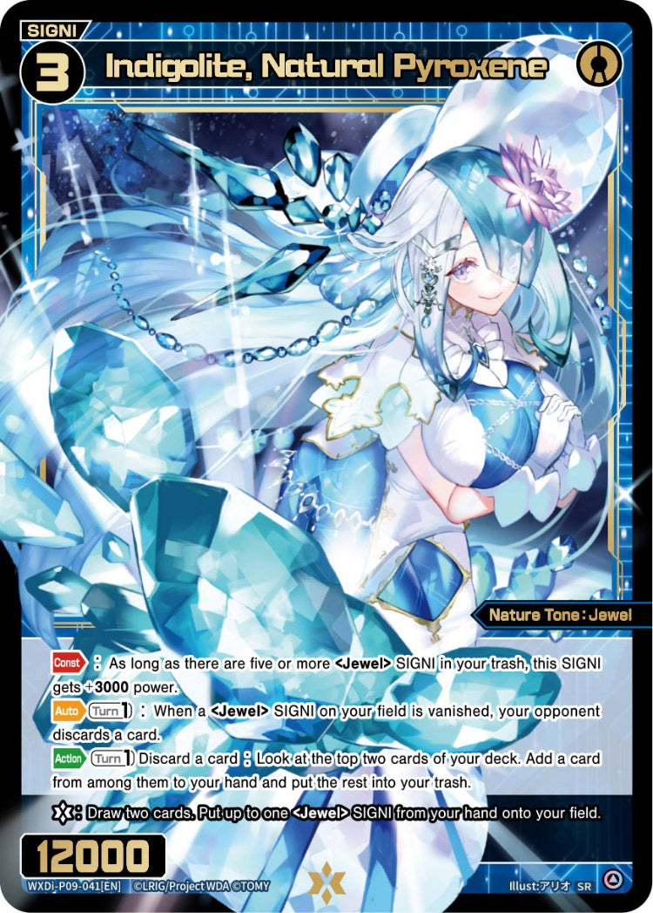

# Indigolite, Natural Pyroxene

## Thông tin lá

| Trường | Giá trị |
| --- | --- |
| Mã in | WXDi-P09-041[EN] |
| Set | WXDi-P09[EN] |
| Số thứ tự | 041 |
| Loại thẻ | SIGNI |
| Vị trí | Main Deck |
| Số bản | — (set booster, không áp dụng) |
| Màu | Xanh dương |
| Độ hiếm | SR,SRP |
| Minh họa | アリオ |
| Level | 3 |
| Limit | — |
| Power | 12000 |
| LRIG type / Class | Nature Tone：Jewel |
| Team / Master | — |
| Cost | — |
| Grow cost | — |
| Use timing | — |
| Life Burst | Có |

## Card text chính thức

[Constant]: As long as there are five or more <Jewel> SIGNI in your trash, this SIGNI gets +3000 power.
[Auto] {1/Turn}: When a <Jewel> SIGNI on your field is vanished, your opponent discards a card.
[Action] {1/Turn} Discard a card: Look at the top two cards of your deck. Add a card from among them to your hand and put the rest into your trash.

## Power text / Life Burst

Draw two cards. Put up to one <Jewel> SIGNI from your hand onto your field.

## Ghi chú minh họa
Artist: アリオ. Ảnh SR được tải từ Card List tiếng Anh.

## FAQ chính thức

**Q. Does the [Auto] ability trigger even when this SIGNI itself is vanished?**
A. Yes, it triggers.

**Q. May I put both cards you looked into my trash without adding them to my hand using the [Action] ability?**
A. No, you cannot. Please add one of the cards to your hand.

## Ảnh biến thể

- [SRP](../images/WXDi-P09-041P-EN.jpg)

## Nguồn
[Card List/FAQ chính thức](https://www.takaratomy.co.jp/products/en.wixoss/card/card.html?card_no=WXDi-P09-041%5BEN%5D ) · [Ảnh thẻ](https://www.takaratomy.co.jp/products/en.wixoss/card/thumb/WXDi-P09-041%5BEN%5D.jpg)
