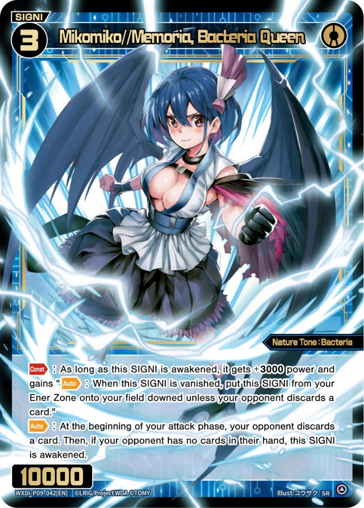

# Mikomiko//Memoria, Bacteria Queen

## Thông tin lá

| Trường | Giá trị |
| --- | --- |
| Mã in | WXDi-P09-042[EN] |
| Set | WXDi-P09[EN] |
| Số thứ tự | 042 |
| Loại thẻ | SIGNI |
| Vị trí | Main Deck |
| Số bản | — (set booster, không áp dụng) |
| Màu | Xanh dương |
| Độ hiếm | SR,SRP |
| Minh họa | コウサク |
| Level | 3 |
| Limit | — |
| Power | 10000 |
| LRIG type / Class | Nature Tone：Bacteria |
| Team / Master | — |
| Cost | — |
| Grow cost | — |
| Use timing | — |
| Life Burst | Không |

## Card text chính thức

[Constant]: As long as this SIGNI is awakened, it gets +3000 power and gains "[Auto]: When this SIGNI is vanished, put this SIGNI from your Ener Zone onto your field downed unless your opponent discards a card."
[Auto]: At the beginning of your attack phase, your opponent discards a card. Then, if your opponent has no cards in their hand, this SIGNI is awakened.

## Power text / Life Burst

—

## Ghi chú minh họa
Artist: コウサク. Ảnh SR được tải từ Card List tiếng Anh.

## FAQ chính thức

**Q. Is the 《Mikomiko//Memoria, Bacteria Queen》 that returned to the field from the Ener Zone in the downed after being vanished still in the awakened?**
A. No, it is not in the awakened since it has left the field once.

## Ảnh biến thể

- [SRP](../images/WXDi-P09-042P-EN.jpg)

## Nguồn
[Card List/FAQ chính thức](https://www.takaratomy.co.jp/products/en.wixoss/card/card.html?card_no=WXDi-P09-042%5BEN%5D ) · [Ảnh thẻ](https://www.takaratomy.co.jp/products/en.wixoss/card/thumb/WXDi-P09-042%5BEN%5D.jpg)
