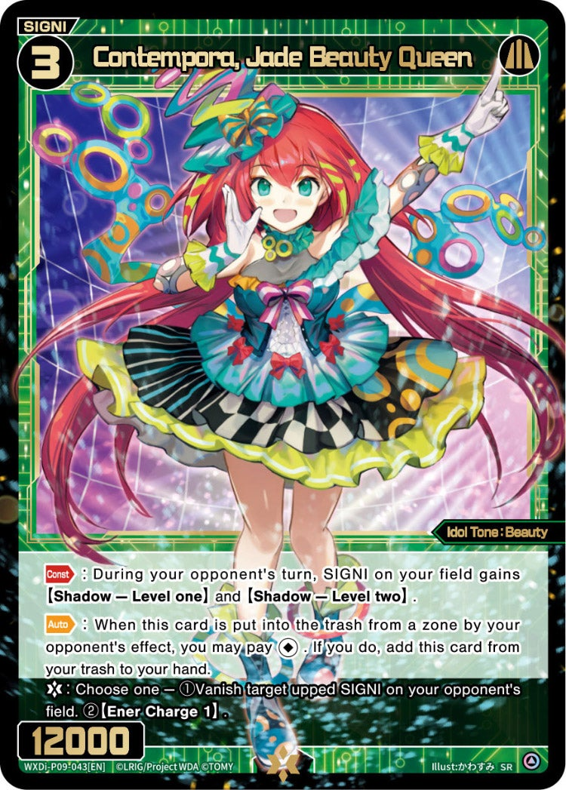

# Contempora, Jade Beauty Queen

## Thông tin lá

| Trường | Giá trị |
| --- | --- |
| Mã in | WXDi-P09-043[EN] |
| Set | WXDi-P09[EN] |
| Số thứ tự | 043 |
| Loại thẻ | SIGNI |
| Vị trí | Main Deck |
| Số bản | — (set booster, không áp dụng) |
| Màu | Xanh lá |
| Độ hiếm | SR,SRP |
| Minh họa | かわすみ |
| Level | 3 |
| Limit | — |
| Power | 12000 |
| LRIG type / Class | Idol Tone：Beauty |
| Team / Master | — |
| Cost | — |
| Grow cost | — |
| Use timing | — |
| Life Burst | Có |

## Card text chính thức

[Constant]: During your opponent's turn, SIGNI on your field gains 【Shadow — Level one】 and 【Shadow — Level two】.

[Auto]: When this card is put into the trash from a zone by your opponent's effect, you may pay {Colorless}. If you do, add this card from your trash to your hand.

## Power text / Life Burst

Choose one — ①Vanish target upped SIGNI on your opponent's field. ②【Ener Charge 1】.

## Ghi chú minh họa
Artist: かわすみ. Ảnh SR được tải từ Card List tiếng Anh.

## FAQ chính thức

**Q. What are the abilities of 【Shadow - Level one】 and 【Shadow - Level two】?**
A. A SIGNI with 【Shadow - Level one】 and 【Shadow - Level two】 is not targeted by the abilities or effects of your opponent's level one and level two SIGNI or LRIG. It is likewise not targeted by the Life Burst of your opponent's level one and level two SIGNI or LRIG.

**Q. When my opponent's effect caused cards from my deck to be put into my trash, and this SIGNI was among them, and simultaneously the deck became zero cards. May I trigger this SIGNI's [Auto] ability and add it to my hand?**
A. No, you cannot add it to your hand. Before the [Auto] ability of this SIGNI triggers, Rule-based action called refresh is performed because the deck has become zero cards. As a result of refresh, this SIGNI is not in your trash, so it cannot be added from the trash to your hand.

**Q. The [Auto] ability of my opponent's 《Yukayuka☆Threee》 trigger, which states "Whenever a SIGNI on your opponent's field attacks, it loses its abilities until end of turn unless your opponent pays {colorless}." and I was paid its {colorless} cost using 《Contempora, Jade Beauty Queen》 in my Ener Zone. In this case, does the [Auto] ability of 《Contempora, Jade Beauty Queen》 trigger?**
A. No, it does not trigger. Moving from the Ener Zone to your trash as a result of paying an Ener cost is considered a cost-related movement.

**Q. When my opponent's effect puts cards from my deck into my trash, causing the deck to have zero cards. After performing the refresh and placing one Life Cloth into the trash, it happened to be the card 《Contempora, Jade Beauty Queen》. Does the [Auto] ability trigger?**
A. No, it doesn't trigger. The fact that the deck became zero cards is due to your opponent's effect, and the subsequent refresh is Rule-based action that doesn't trigger abilities.

**Q. If this SIGNI had its power reduced to 0 by my opponent's effect, and it was put into my trash instead of being vanished due to a replacement effect that states "When it would be vanished, it is put into your trash instead", would the second [Auto] ability trigger?**
A. No, it doesn't trigger. The effect that reduces the power to 0 may be caused by your opponent, but the vanishing resulting from having a power of 0 is rule-based action and not considered as being moved due to your opponent's effect. The same applies to vanish caused by battle; it is not considered to be caused by your opponent's effect.

**Q. If this SIGNI loses its abilities while on the field due to some effect, and then it is put into my trash by an effect from my opponent, does its [Auto] ability trigger?**
A. No, it doesn't trigger. If the SIGNI loses its abilities before being moved to another zone, it doesn't trigger any abilities that would ttrigger upon moving.

**Q. If the top card of my deck is put into my trash by my opponent's effect, and if that card happens to be this SIGNI, does its [Auto] ability trigger?**
A. Yes, it triggers.

**Q. If I discarded this SIGNI from my hand due to the effect of my opponent, does its [Auto] ability trigger?**
A. Yes, it triggers.

## Ảnh biến thể

- [SRP](../images/WXDi-P09-043P-EN.jpg)

## Nguồn
[Card List/FAQ chính thức](https://www.takaratomy.co.jp/products/en.wixoss/card/card.html?card_no=WXDi-P09-043%5BEN%5D ) · [Ảnh thẻ](https://www.takaratomy.co.jp/products/en.wixoss/card/thumb/WXDi-P09-043%5BEN%5D.jpg)
