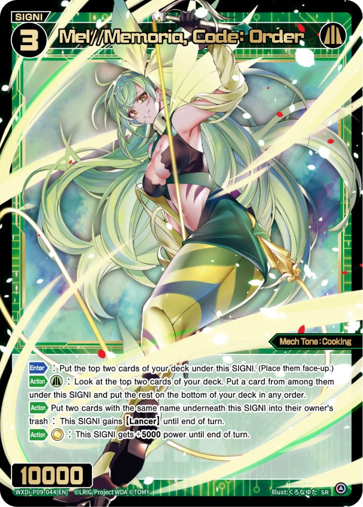

# Mel//Memoria, Code: Order

## Thông tin lá

| Trường | Giá trị |
| --- | --- |
| Mã in | WXDi-P09-044[EN] |
| Set | WXDi-P09[EN] |
| Số thứ tự | 044 |
| Loại thẻ | SIGNI |
| Vị trí | Main Deck |
| Số bản | — (set booster, không áp dụng) |
| Màu | Xanh lá |
| Độ hiếm | SR,SRP |
| Minh họa | くろなゆた |
| Level | 3 |
| Limit | — |
| Power | 10000 |
| LRIG type / Class | Mech Tone：Cooking |
| Team / Master | — |
| Cost | — |
| Grow cost | — |
| Use timing | — |
| Life Burst | Không |

## Card text chính thức

[Enter]: Put the top two cards of your deck under this SIGNI. (Place them face-up.)
[Action] {Green}: Look at the top two cards of your deck. Put a card from among them under this SIGNI and put the rest on the bottom of your deck in any order.
[Action] Put two cards with the same name underneath this SIGNI into their owner's trash: This SIGNI gains 【Lancer】 until end of turn.
[Action] {Coin Icon}: This SIGNI gets +5000 power until end of turn.

## Power text / Life Burst

—

## Ghi chú minh họa
Artist: くろなゆた. Ảnh SR được tải từ Card List tiếng Anh.

## FAQ chính thức

**Q. When this SIGNI leave the field, what happens to the cards placed under it?**
A. The card placed under is put into the Trash by the Rule-based action.

## Ảnh biến thể

- [SRP](../images/WXDi-P09-044P-EN.jpg)

## Nguồn
[Card List/FAQ chính thức](https://www.takaratomy.co.jp/products/en.wixoss/card/card.html?card_no=WXDi-P09-044%5BEN%5D ) · [Ảnh thẻ](https://www.takaratomy.co.jp/products/en.wixoss/card/thumb/WXDi-P09-044%5BEN%5D.jpg)
