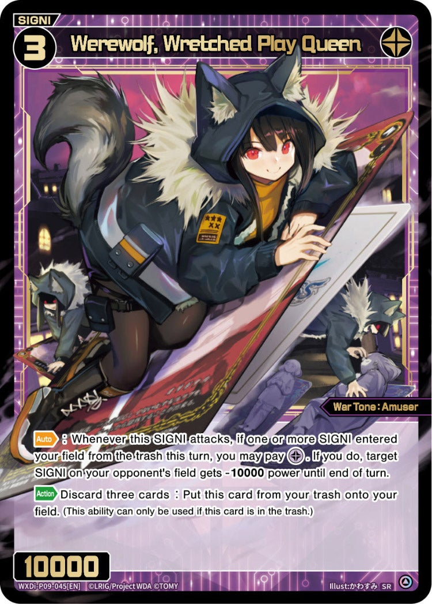

# Werewolf, Wretched Play Queen

## Thông tin lá

| Trường | Giá trị |
| --- | --- |
| Mã in | WXDi-P09-045[EN] |
| Set | WXDi-P09[EN] |
| Số thứ tự | 045 |
| Loại thẻ | SIGNI |
| Vị trí | Main Deck |
| Số bản | — (set booster, không áp dụng) |
| Màu | Đen |
| Độ hiếm | SR,SRP |
| Minh họa | かわすみ |
| Level | 3 |
| Limit | — |
| Power | 10000 |
| LRIG type / Class | War Tone：Amuser |
| Team / Master | — |
| Cost | — |
| Grow cost | — |
| Use timing | — |
| Life Burst | Không |

## Card text chính thức

[Auto]: Whenever this SIGNI attacks, if one or more SIGNI entered your field from the trash this turn, you may pay {Black}. If you do, target SIGNI on your opponent's field gets -10000 power until end of turn.

[Action] Discard three cards: Put this card from your trash onto your field. (This ability can only be used if this card is in the trash.)

## Power text / Life Burst

—

## Ghi chú minh họa
Artist: かわすみ. Ảnh SR được tải từ Card List tiếng Anh.

## FAQ chính thức

**Q. May this card be put directly on the field when it is discarded from my hand using its [Action] ability?**
A. No, it cannot. Without this card being in your trash, you cannot declare the use of the [Action] ability, and you cannot discard it from the hand.

**Q. If this card is put on the field from my trash and attacks after using its [Action] ability, does it met the condition "if one or more SIGNI entered your field from the trash this turn"?**
A. Yes, it meets the condition of the [Auto] ability if it is the SIGNI that entered the field from your trash during that turn.

## Ảnh biến thể

- [SRP](../images/WXDi-P09-045P-EN.jpg)

## Nguồn
[Card List/FAQ chính thức](https://www.takaratomy.co.jp/products/en.wixoss/card/card.html?card_no=WXDi-P09-045%5BEN%5D ) · [Ảnh thẻ](https://www.takaratomy.co.jp/products/en.wixoss/card/thumb/WXDi-P09-045%5BEN%5D.jpg)
