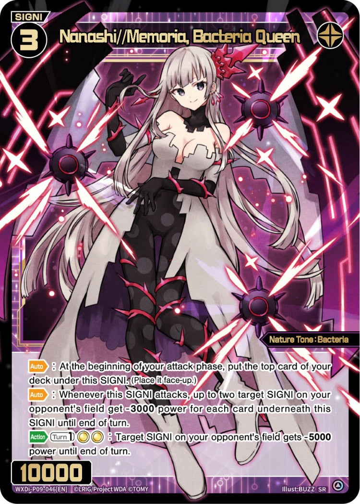

# Nanashi//Memoria, Bacteria Queen

## Thông tin lá

| Trường | Giá trị |
| --- | --- |
| Mã in | WXDi-P09-046[EN] |
| Set | WXDi-P09[EN] |
| Số thứ tự | 046 |
| Loại thẻ | SIGNI |
| Vị trí | Main Deck |
| Số bản | — (set booster, không áp dụng) |
| Màu | Đen |
| Độ hiếm | SR,SRP |
| Minh họa | BUZZ |
| Level | 3 |
| Limit | — |
| Power | 10000 |
| LRIG type / Class | Nature Tone：Bacteria |
| Team / Master | — |
| Cost | — |
| Grow cost | — |
| Use timing | — |
| Life Burst | Không |

## Card text chính thức

[Auto]: At the beginning of your attack phase, put the top card of your deck under this SIGNI. (Place it face-up.)
[Auto]: Whenever this SIGNI attacks, up to two target SIGNI on your opponent's field get -3000 power for each card underneath this SIGNI until end of turn.
[Action] {1/Turn} {Coin Icon} {Coin Icon}: Target SIGNI on your opponent's field gets -5000 power until end of turn.

## Power text / Life Burst

—

## Ghi chú minh họa
Artist: BUZZ. Ảnh SR được tải từ Card List tiếng Anh.

## FAQ chính thức

**Q. When this SIGNI leaves the field, what happens to the cards placed under it?**
A. The card placed under is put into the Trash by the Rule-based action.

## Ảnh biến thể

- [SRP](../images/WXDi-P09-046P-EN.jpg)

## Nguồn
[Card List/FAQ chính thức](https://www.takaratomy.co.jp/products/en.wixoss/card/card.html?card_no=WXDi-P09-046%5BEN%5D ) · [Ảnh thẻ](https://www.takaratomy.co.jp/products/en.wixoss/card/thumb/WXDi-P09-046%5BEN%5D.jpg)
