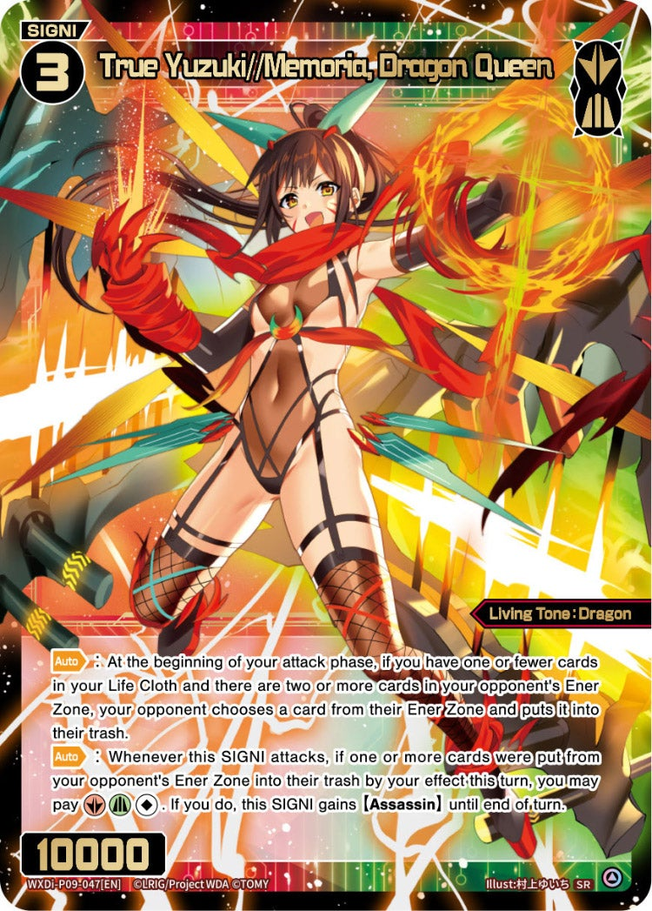

# True Yuzuki//Memoria, Dragon Queen

## Thông tin lá

| Trường | Giá trị |
| --- | --- |
| Mã in | WXDi-P09-047[EN] |
| Set | WXDi-P09[EN] |
| Số thứ tự | 047 |
| Loại thẻ | SIGNI |
| Vị trí | Main Deck |
| Số bản | — (set booster, không áp dụng) |
| Màu | Đỏ / xanh lá |
| Độ hiếm | SR,SRP |
| Minh họa | 村上ゆいち |
| Level | 3 |
| Limit | — |
| Power | 10000 |
| LRIG type / Class | Living Tone：Dragon |
| Team / Master | — |
| Cost | — |
| Grow cost | — |
| Use timing | — |
| Life Burst | Không |

## Card text chính thức

[Auto]: At the beginning of your attack phase, if you have one or fewer cards in your Life Cloth and there are two or more cards in your opponent's Ener Zone, your opponent chooses a card from their Ener Zone and puts it into their trash.
[Auto]: Whenever this SIGNI attacks, if one or more cards were put from your opponent's Ener Zone into their trash by your effect this turn, you may pay {Red} {Green} {Colorless}. If you do, this SIGNI gains 【Assassin】 until end of turn.

## Power text / Life Burst

—

## Ghi chú minh họa
Artist: 村上ゆいち. Ảnh SR được tải từ Card List tiếng Anh.

## FAQ chính thức

**Q. The effect of my card causes my opponent to pay the Ener cost. Does it meet the condition of the second [Auto] ability, "if one or more cards were put from your opponent's Ener Zone into their trash by your effect this turn"?**
A. No, in that case, the cards were not put from the Ener Zone into its owner's trash by the effect. Moving cards from the Ener Zone to the trash due to the payment of Ener cost is considered as a cost-based movement, not an effect-based movement.

## Ảnh biến thể

- [SRP](../images/WXDi-P09-047P-EN.jpg)

## Nguồn
[Card List/FAQ chính thức](https://www.takaratomy.co.jp/products/en.wixoss/card/card.html?card_no=WXDi-P09-047%5BEN%5D ) · [Ảnh thẻ](https://www.takaratomy.co.jp/products/en.wixoss/card/thumb/WXDi-P09-047%5BEN%5D.jpg)
