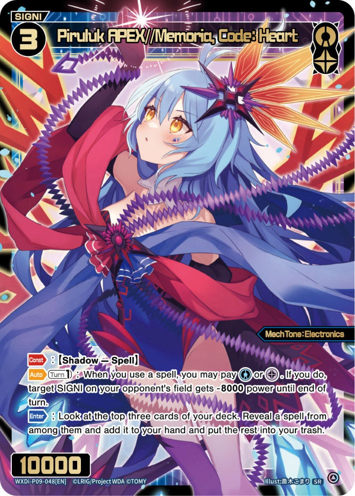

# Piruluk APEX//Memoria, Code: Heart

## Thông tin lá

| Trường | Giá trị |
| --- | --- |
| Mã in | WXDi-P09-048[EN] |
| Set | WXDi-P09[EN] |
| Số thứ tự | 048 |
| Loại thẻ | SIGNI |
| Vị trí | Main Deck |
| Số bản | — (set booster, không áp dụng) |
| Màu | Xanh dương / đen |
| Độ hiếm | SR,SRP |
| Minh họa | 斎木こまり |
| Level | 3 |
| Limit | — |
| Power | 10000 |
| LRIG type / Class | Mech Tone：Electronics |
| Team / Master | — |
| Cost | — |
| Grow cost | — |
| Use timing | — |
| Life Burst | Không |

## Card text chính thức

[Constant]: 【Shadow — Spell】
[Auto] {1/Turn}: When you use a spell, you may pay {Blue} or {Black}. If you do, target SIGNI on your opponent's field gets -8000 power until end of turn.
[Enter]: Look at the top three cards of your deck. Reveal a spell from among them and add it to your hand and put the rest into your trash.

## Power text / Life Burst

—

## Ghi chú minh họa
Artist: 斎木こまり. Ảnh SR được tải từ Card List tiếng Anh.

## FAQ chính thức

**Q. Is this card with 【Shadow - Spell】 targeted by the Life Burst effect of a spell?**
A. No. If it is a card of a spell, even if it is a Life Burst, it is not targeted to the effect.

**Q. Is the [Auto] ability of this SIGNI triggered when the spell of Life Burst is triggered?**
A. No, it doesn't trigger. The triggering of spell of Life Burst is not considered as spell usage.

## Ảnh biến thể

- [SRP](../images/WXDi-P09-048P-EN.jpg)

## Nguồn
[Card List/FAQ chính thức](https://www.takaratomy.co.jp/products/en.wixoss/card/card.html?card_no=WXDi-P09-048%5BEN%5D ) · [Ảnh thẻ](https://www.takaratomy.co.jp/products/en.wixoss/card/thumb/WXDi-P09-048%5BEN%5D.jpg)
