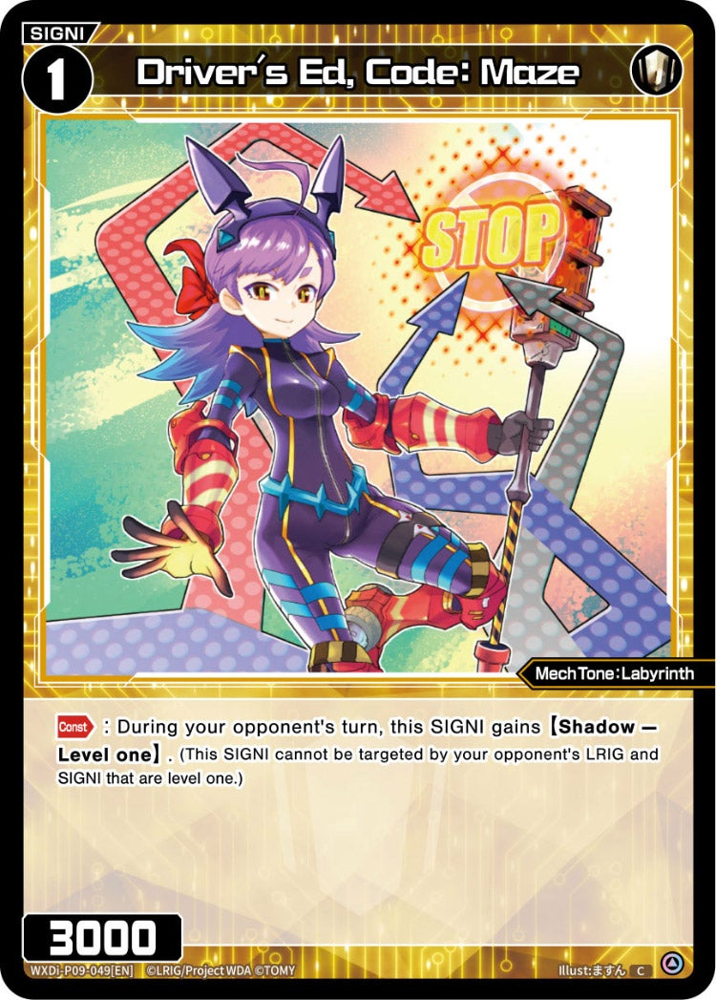

# Driver's Ed, Code: Maze

## Thông tin lá

| Trường | Giá trị |
| --- | --- |
| Mã in | WXDi-P09-049[EN] |
| Set | WXDi-P09[EN] |
| Số thứ tự | 049 |
| Loại thẻ | SIGNI |
| Vị trí | Main Deck |
| Số bản | — (set booster, không áp dụng) |
| Màu | Trắng |
| Độ hiếm | C,C(P) |
| Minh họa | ますん |
| Level | 1 |
| Limit | — |
| Power | 3000 |
| LRIG type / Class | Mech Tone：Labyrinth |
| Team / Master | — |
| Cost | — |
| Grow cost | — |
| Use timing | — |
| Life Burst | Không |

## Card text chính thức

[Constant]: During your opponent's turn, this SIGNI gains 【Shadow — Level one】. (This SIGNI cannot be targeted by your opponent's LRIG and SIGNI that are level one.)

## Power text / Life Burst

—

## Ghi chú minh họa
Artist: ますん. Ảnh C được tải từ Card List tiếng Anh.

## FAQ chính thức

**Q. Is this card with 【Shadow - Level one】 targeted by the Life Burst effect of a level one SIGNI?**
A. No. If it is a card of a level one SIGNI, even if it is a Life Burst, it is not targeted to the effect.

## Ảnh biến thể

- [C(P)](../images/WXDi-P09-049P-EN.jpg)

## Nguồn
[Card List/FAQ chính thức](https://www.takaratomy.co.jp/products/en.wixoss/card/card.html?card_no=WXDi-P09-049%5BEN%5D ) · [Ảnh thẻ](https://www.takaratomy.co.jp/products/en.wixoss/card/thumb/WXDi-P09-049%5BEN%5D.jpg)
