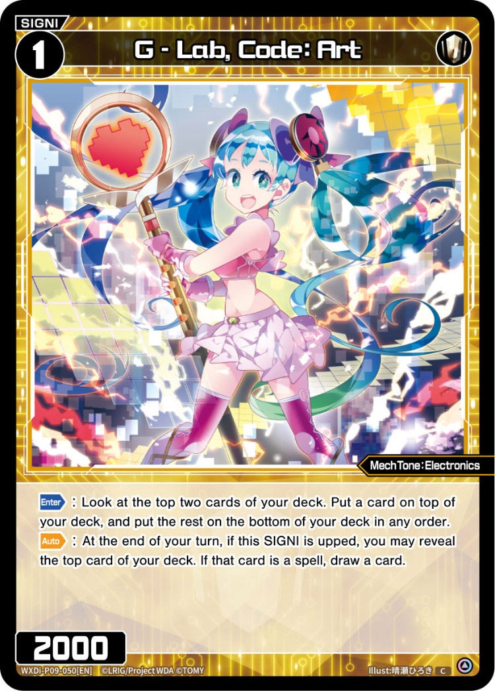

# G-Lab, Code: Art

## Thông tin lá

| Trường | Giá trị |
| --- | --- |
| Mã in | WXDi-P09-050[EN] |
| Set | WXDi-P09[EN] |
| Số thứ tự | 050 |
| Loại thẻ | SIGNI |
| Vị trí | Main Deck |
| Số bản | — (set booster, không áp dụng) |
| Màu | Trắng |
| Độ hiếm | C,C(P) |
| Minh họa | 晴瀬ひろき |
| Level | 1 |
| Limit | — |
| Power | 2000 |
| LRIG type / Class | Mech Tone：Electronics |
| Team / Master | — |
| Cost | — |
| Grow cost | — |
| Use timing | — |
| Life Burst | Không |

## Card text chính thức

[Enter]: Look at the top two cards of your deck. Put a card on top of your deck, and put the rest on the bottom of your deck in any order.
[Auto]: At the end of your turn, if this SIGNI is upped, you may reveal the top card of your deck. If that card is a spell, draw a card.

## Power text / Life Burst

—

## Ghi chú minh họa
Artist: 晴瀬ひろき. Ảnh C được tải từ Card List tiếng Anh.

## FAQ chính thức

**Q. May I put both of the revealed cards to the bottom of my deck by this [Enter] ability?**
A. No, you must return one of the two cards to the top of your deck.

## Ảnh biến thể

- [C(P)](../images/WXDi-P09-050P-EN.jpg)

## Nguồn
[Card List/FAQ chính thức](https://www.takaratomy.co.jp/products/en.wixoss/card/card.html?card_no=WXDi-P09-050%5BEN%5D ) · [Ảnh thẻ](https://www.takaratomy.co.jp/products/en.wixoss/card/thumb/WXDi-P09-050%5BEN%5D.jpg)
