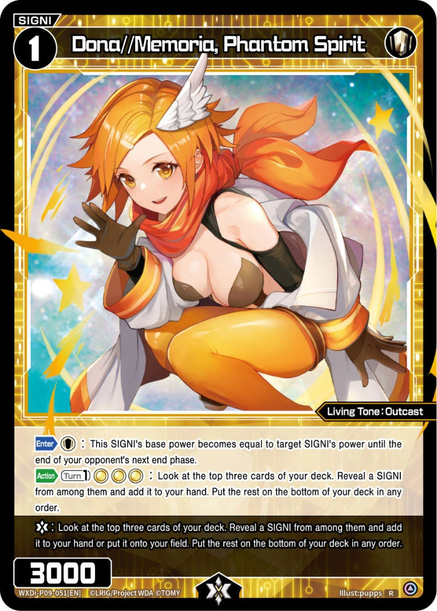

# Dona//Memoria, Phantom Spirit

## Thông tin lá

| Trường | Giá trị |
| --- | --- |
| Mã in | WXDi-P09-051[EN] |
| Set | WXDi-P09[EN] |
| Số thứ tự | 051 |
| Loại thẻ | SIGNI |
| Vị trí | Main Deck |
| Số bản | — (set booster, không áp dụng) |
| Màu | Trắng |
| Độ hiếm | R,R(P) |
| Minh họa | pupps |
| Level | 1 |
| Limit | — |
| Power | 3000 |
| LRIG type / Class | Living Tone：Outcast |
| Team / Master | — |
| Cost | — |
| Grow cost | — |
| Use timing | — |
| Life Burst | Có |

## Card text chính thức

[Enter] {White}: This SIGNI's base power becomes equal to target SIGNI's power until the end of your opponent's next end phase.
[Action] {1/Turn} {Coin Icon} {Coin Icon} {Coin Icon}: Look at the top three cards of your deck. Reveal a SIGNI from among them and add it to your hand. Put the rest on the bottom of your deck in any order.

## Power text / Life Burst

Look at the top three cards of your deck. Reveal a SIGNI from among them and add it to your hand or put it onto your field. Put the rest on the bottom of your deck in any order.

## Ghi chú minh họa
Artist: pupps. Ảnh R được tải từ Card List tiếng Anh.

## FAQ chính thức

**Q. If a SIGNI with power 5000 is being increased by an effect to get +3000 power, and I put this SIGNI on the field and use this SIGNI's effect that targets it, what happens?**
A. The base power of this SIGNI becomes 8000.

**Q. When my Center LRIG is 《Hirana, a Step Towards the Glimmer》, I put this SIGNI on the center SIGNI zone. With the effect of 《Hirana, a Step Towards the Glimmer》 that states "[Const]: During your turn, SIGNI in your center SIGNI Zone get +3000 power.", and trigger the [Enter] ability of this SIGNI, targeting itself, what will be the final power?**
A. The final power will be 9000.
The original power 3000 is increased by +3000 from the continuous effect of 《Hirana, a Step Towards the Glimmer》, resulting in power 6000. Additionally, with the [Enter] ability of this SIGNI, the base power becomes 6000.
Furthermore, the base power is increased by +3000 from 《Hirana, a Step Towards the Glimmer》, resulting in power 9000.

## Ảnh biến thể

- [R(P)](../images/WXDi-P09-051P-EN.jpg)

## Nguồn
[Card List/FAQ chính thức](https://www.takaratomy.co.jp/products/en.wixoss/card/card.html?card_no=WXDi-P09-051%5BEN%5D ) · [Ảnh thẻ](https://www.takaratomy.co.jp/products/en.wixoss/card/thumb/WXDi-P09-051%5BEN%5D.jpg)
