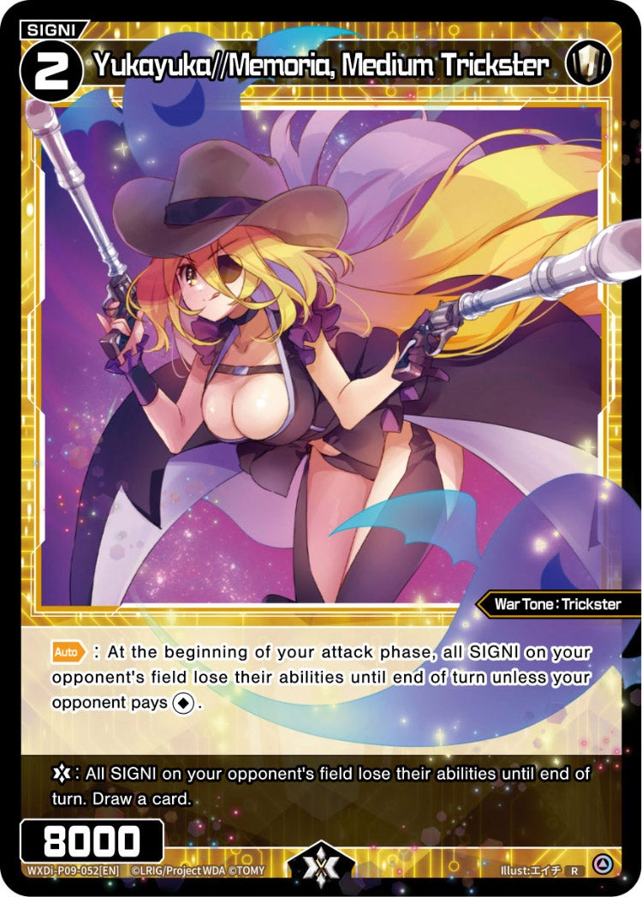

# Yukayuka//Memoria, Medium Trickster

## Thông tin lá

| Trường | Giá trị |
| --- | --- |
| Mã in | WXDi-P09-052[EN] |
| Set | WXDi-P09[EN] |
| Số thứ tự | 052 |
| Loại thẻ | SIGNI |
| Vị trí | Main Deck |
| Số bản | — (set booster, không áp dụng) |
| Màu | Trắng |
| Độ hiếm | R,R(P) |
| Minh họa | エイチ |
| Level | 2 |
| Limit | — |
| Power | 8000 |
| LRIG type / Class | War Tone：Trickster |
| Team / Master | — |
| Cost | — |
| Grow cost | — |
| Use timing | — |
| Life Burst | Có |

## Card text chính thức

[Auto]: At the beginning of your attack phase, all SIGNI on your opponent's field lose their abilities until end of turn unless your opponent pays {Colorless}.

## Power text / Life Burst

All SIGNI on your opponent's field lose their abilities until end of turn. Draw a card.

## Ghi chú minh họa
Artist: エイチ. Ảnh R được tải từ Card List tiếng Anh.

## FAQ chính thức

**Q. I trigger this SIGNI's Life Burst or an [Auto] ability. Does the SIGNI that enters the opponent's field after resolving this Life Burst or an [Auto] ability during that turn lose its abilities?**
A. No, it does not lose abilities. This effect only affects the SIGNI on your opponent's field at the time of Life Burst or an [Auto] ability resolved.

## Ảnh biến thể

- [R(P)](../images/WXDi-P09-052P-EN.jpg)

## Nguồn
[Card List/FAQ chính thức](https://www.takaratomy.co.jp/products/en.wixoss/card/card.html?card_no=WXDi-P09-052%5BEN%5D ) · [Ảnh thẻ](https://www.takaratomy.co.jp/products/en.wixoss/card/thumb/WXDi-P09-052%5BEN%5D.jpg)
