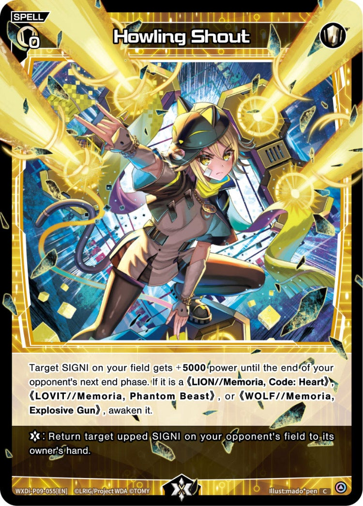

# Howling Shout

## Thông tin lá

| Trường | Giá trị |
| --- | --- |
| Mã in | WXDi-P09-055[EN] |
| Set | WXDi-P09[EN] |
| Số thứ tự | 055 |
| Loại thẻ | SPELL |
| Vị trí | Main Deck |
| Số bản | — (set booster, không áp dụng) |
| Màu | Trắng |
| Độ hiếm | C,C(P) |
| Minh họa | mado*pen |
| Level | — |
| Limit | — |
| Power | 0 |
| LRIG type / Class | — |
| Team / Master | — |
| Cost | 《W》×０ |
| Grow cost | — |
| Use timing | — |
| Life Burst | Có |

## Card text chính thức

Target SIGNI on your field gets +5000 power until the end of your opponent's next end phase. If it is a 《LION//Memoria, Code: Heart》, 《LOVIT//Memoria, Phantom Beast》, or 《WOLF//Memoria, Explosive Gun》, awaken it.

## Power text / Life Burst

Return target upped SIGNI on your opponent's field to its owner's hand.

## Ghi chú minh họa
Artist: mado*pen. Ảnh C được tải từ Card List tiếng Anh.

## FAQ chính thức

— (không có FAQ riêng cho mã này trên trang FAQ tiếng Anh.)

## Ảnh biến thể

- [C(P)](../images/WXDi-P09-055P-EN.jpg)

## Nguồn
[Card List/FAQ chính thức](https://www.takaratomy.co.jp/products/en.wixoss/card/card.html?card_no=WXDi-P09-055%5BEN%5D ) · [Ảnh thẻ](https://www.takaratomy.co.jp/products/en.wixoss/card/thumb/WXDi-P09-055%5BEN%5D.jpg)
