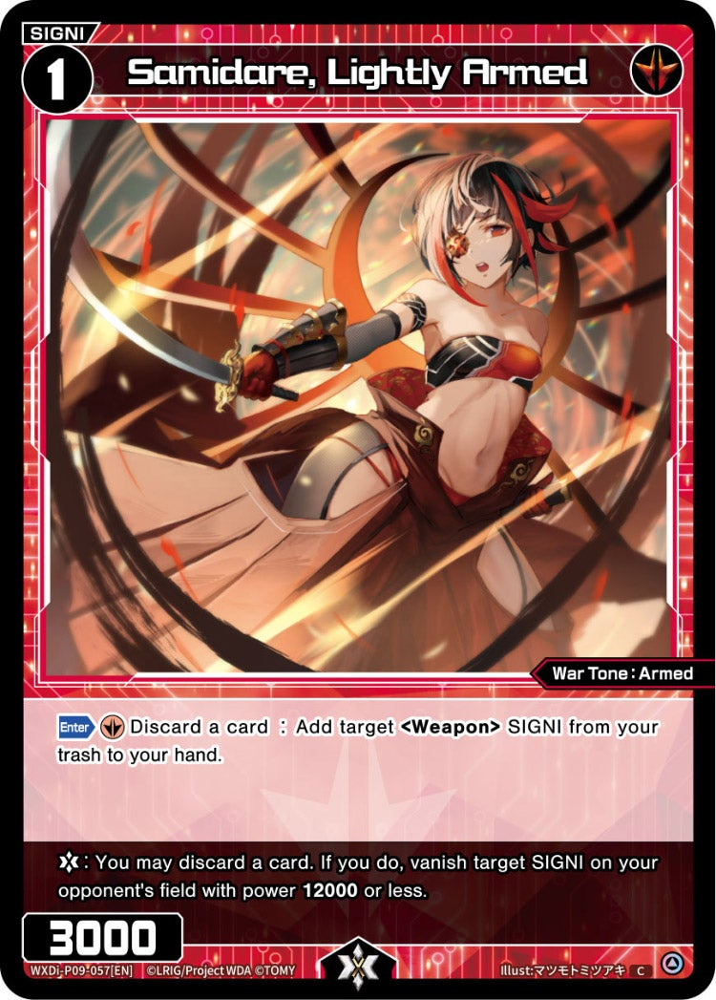

# Samidare, Lightly Armed

## Thông tin lá

| Trường | Giá trị |
| --- | --- |
| Mã in | WXDi-P09-057[EN] |
| Set | WXDi-P09[EN] |
| Số thứ tự | 057 |
| Loại thẻ | SIGNI |
| Vị trí | Main Deck |
| Số bản | — (set booster, không áp dụng) |
| Màu | Đỏ |
| Độ hiếm | C,C(P) |
| Minh họa | マツモトミツアキ |
| Level | 1 |
| Limit | — |
| Power | 3000 |
| LRIG type / Class | War Tone：Armed |
| Team / Master | — |
| Cost | — |
| Grow cost | — |
| Use timing | — |
| Life Burst | Có |

## Card text chính thức

[Enter] {Red} Discard a card: Add target <Weapon> SIGNI from your trash to your hand.

## Power text / Life Burst

You may discard a card. If you do, vanish target SIGNI on your opponent's field with power 12000 or less.

## Ghi chú minh họa
Artist: マツモトミツアキ. Ảnh C được tải từ Card List tiếng Anh.

## FAQ chính thức

**Q. May the card paid with {red} cost of the [Enter] ability be directly added to my hand through this effect?**
A. Yes, if it is a <Weapon> SIGNI, it can be targeted and added to your hand.

## Ảnh biến thể

- [C(P)](../images/WXDi-P09-057P-EN.jpg)

## Nguồn
[Card List/FAQ chính thức](https://www.takaratomy.co.jp/products/en.wixoss/card/card.html?card_no=WXDi-P09-057%5BEN%5D ) · [Ảnh thẻ](https://www.takaratomy.co.jp/products/en.wixoss/card/thumb/WXDi-P09-057%5BEN%5D.jpg)
