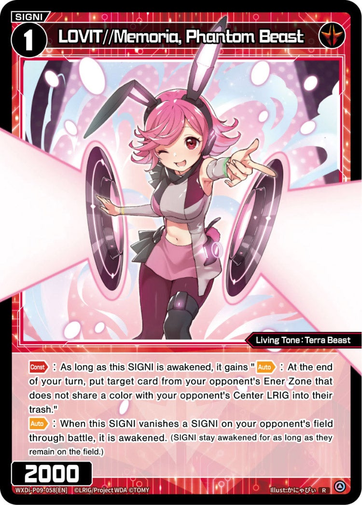

# LOVIT//Memoria, Phantom Beast

## Thông tin lá

| Trường | Giá trị |
| --- | --- |
| Mã in | WXDi-P09-058[EN] |
| Set | WXDi-P09[EN] |
| Số thứ tự | 058 |
| Loại thẻ | SIGNI |
| Vị trí | Main Deck |
| Số bản | — (set booster, không áp dụng) |
| Màu | Đỏ |
| Độ hiếm | R,R(P) |
| Minh họa | かにゃぴぃ |
| Level | 1 |
| Limit | — |
| Power | 2000 |
| LRIG type / Class | Living Tone：Terra Beast |
| Team / Master | — |
| Cost | — |
| Grow cost | — |
| Use timing | — |
| Life Burst | Không |

## Card text chính thức

[Constant]: As long as this SIGNI is awakened, it gains "[Auto]: At the end of your turn, put target card from your opponent's Ener Zone that does not share a color with your opponent's Center LRIG into their trash."
[Auto]: When this SIGNI vanishes a SIGNI on your opponent's field through battle, it is awakened. (SIGNI stay awakened for as long as they remain on the field.)

## Power text / Life Burst

—

## Ghi chú minh họa
Artist: かにゃぴぃ. Ảnh R được tải từ Card List tiếng Anh.

## FAQ chính thức

**Q. After this SIGNI vanished my opponent's SIGNI through battle and awakened, if it vanishes another my opponent's SIGNI through battle on a different turn, does it awaken twice? And if so, does it also gain two [Auto] abilities?**
A. No, an awakened SIGNI does not awaken again even if the conditions are met. It remains with only one [Auto] ability gained from its effect of [Const] ability.

## Ảnh biến thể

- [R(P)](../images/WXDi-P09-058P-EN.jpg)

## Nguồn
[Card List/FAQ chính thức](https://www.takaratomy.co.jp/products/en.wixoss/card/card.html?card_no=WXDi-P09-058%5BEN%5D ) · [Ảnh thẻ](https://www.takaratomy.co.jp/products/en.wixoss/card/thumb/WXDi-P09-058%5BEN%5D.jpg)
