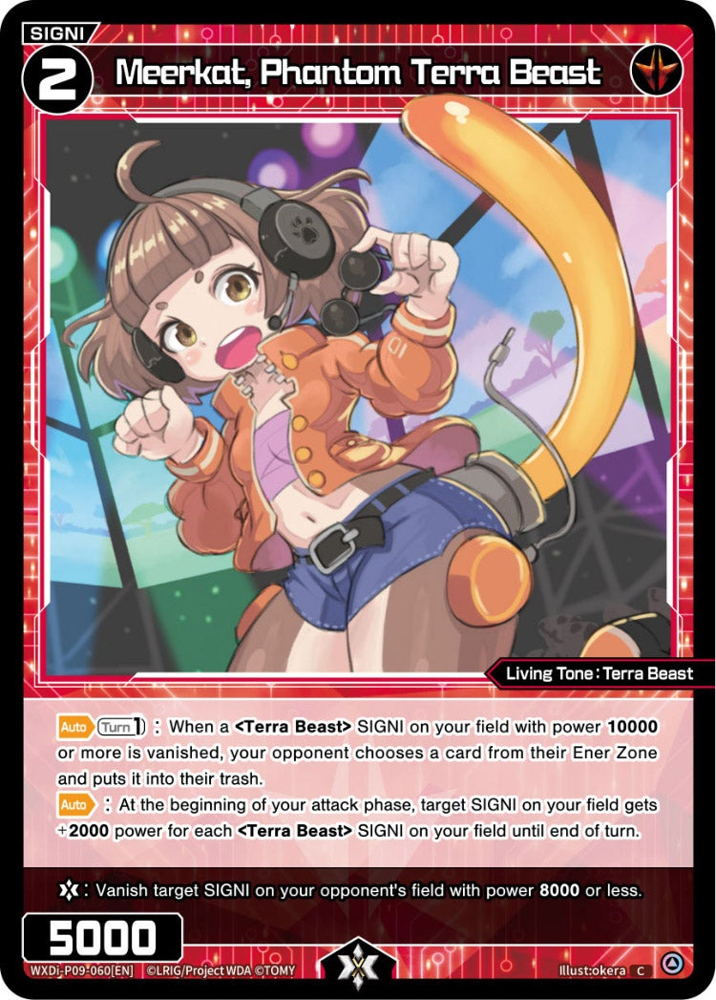

# Meerkat, Phantom Terra Beast

## Thông tin lá

| Trường | Giá trị |
| --- | --- |
| Mã in | WXDi-P09-060[EN] |
| Set | WXDi-P09[EN] |
| Số thứ tự | 060 |
| Loại thẻ | SIGNI |
| Vị trí | Main Deck |
| Số bản | — (set booster, không áp dụng) |
| Màu | Đỏ |
| Độ hiếm | C,C(P) |
| Minh họa | okera |
| Level | 2 |
| Limit | — |
| Power | 5000 |
| LRIG type / Class | Living Tone：Terra Beast |
| Team / Master | — |
| Cost | — |
| Grow cost | — |
| Use timing | — |
| Life Burst | Có |

## Card text chính thức

[Auto] {1/Turn}: When a <Terra Beast> SIGNI on your field with power 10000 or more is vanished, your opponent chooses a card from their Ener Zone and puts it into their trash.
[Auto]: At the beginning of your attack phase, target SIGNI on your field gets +2000 power for each <Terra Beast> SIGNI on your field until end of turn.

## Power text / Life Burst

Vanish target SIGNI on your opponent's field with power 8000 or less.

## Ghi chú minh họa
Artist: okera. Ảnh C được tải từ Card List tiếng Anh.

## FAQ chính thức

**Q. What happens if the number of <Terra Beast> on the field changes after using the second [Auto] ability to increase the power of a SIGNI?**
A. The value of the power increase does not change. Only when this [Auto] ability triggers, the number of <Terra Beast> on the field is counted, and it remains unchanged until the end of the turn.

**Q. When there are two copies of this SIGNI on the field and a <Terra Beast> SIGNI with power 10000 or higher is vanished, what happens to the first [Auto] ability?**
A. The first [Auto] ability will trigger separately for each of them.

## Ảnh biến thể

- [C(P)](../images/WXDi-P09-060P-EN.jpg)

## Nguồn
[Card List/FAQ chính thức](https://www.takaratomy.co.jp/products/en.wixoss/card/card.html?card_no=WXDi-P09-060%5BEN%5D ) · [Ảnh thẻ](https://www.takaratomy.co.jp/products/en.wixoss/card/thumb/WXDi-P09-060%5BEN%5D.jpg)
