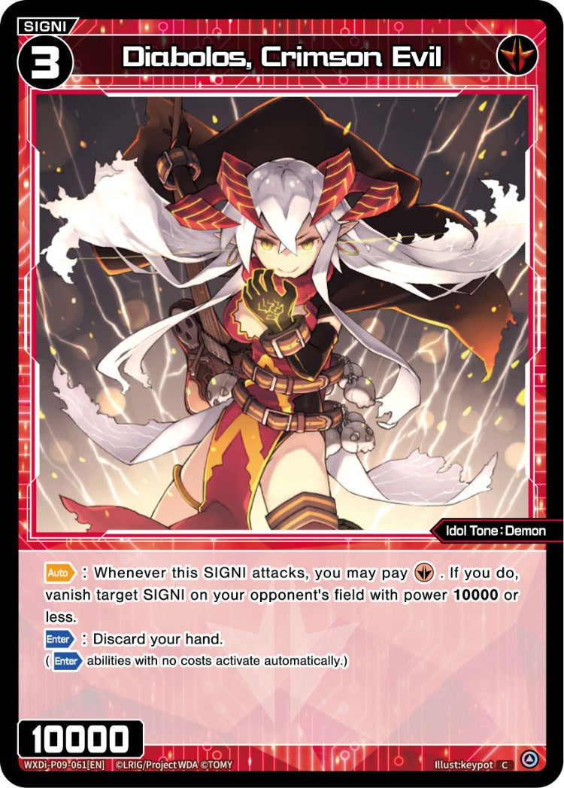

# Diabolos, Crimson Evil

## Thông tin lá

| Trường | Giá trị |
| --- | --- |
| Mã in | WXDi-P09-061[EN] |
| Set | WXDi-P09[EN] |
| Số thứ tự | 061 |
| Loại thẻ | SIGNI |
| Vị trí | Main Deck |
| Số bản | — (set booster, không áp dụng) |
| Màu | Đỏ |
| Độ hiếm | C,C(P) |
| Minh họa | keypot |
| Level | 3 |
| Limit | — |
| Power | 10000 |
| LRIG type / Class | Idol Tone：Demon |
| Team / Master | — |
| Cost | — |
| Grow cost | — |
| Use timing | — |
| Life Burst | Không |

## Card text chính thức

[Auto]: Whenever this SIGNI attacks, you may pay {Red}. If you do, vanish target SIGNI on your opponent's field with power 10000 or less.
[Enter]: Discard your hand.
([Enter] abilities with no costs activate automatically.)

## Power text / Life Burst

—

## Ghi chú minh họa
Artist: keypot. Ảnh C được tải từ Card List tiếng Anh.

## FAQ chính thức

**Q. May I put this SIGNI on the field when it is the only card in my hand?**
A. Yes, you can put it. The [Enter] ability will trigger, but since you have no cards in hand, nothing will happen, and this SIGNI will remain on the field.

## Ảnh biến thể

- [C(P)](../images/WXDi-P09-061P-EN.jpg)

## Nguồn
[Card List/FAQ chính thức](https://www.takaratomy.co.jp/products/en.wixoss/card/card.html?card_no=WXDi-P09-061%5BEN%5D ) · [Ảnh thẻ](https://www.takaratomy.co.jp/products/en.wixoss/card/thumb/WXDi-P09-061%5BEN%5D.jpg)
