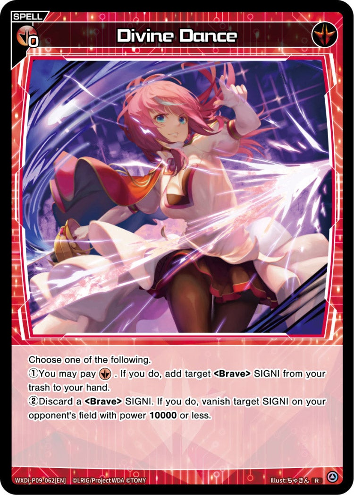

# Divine Dance

## Thông tin lá

| Trường | Giá trị |
| --- | --- |
| Mã in | WXDi-P09-062[EN] |
| Set | WXDi-P09[EN] |
| Số thứ tự | 062 |
| Loại thẻ | SPELL |
| Vị trí | Main Deck |
| Số bản | — (set booster, không áp dụng) |
| Màu | Đỏ |
| Độ hiếm | R,R(P) |
| Minh họa | ちゃきん |
| Level | — |
| Limit | — |
| Power | 0 |
| LRIG type / Class | — |
| Team / Master | — |
| Cost | 《R》×０ |
| Grow cost | — |
| Use timing | — |
| Life Burst | Không |

## Card text chính thức

Choose one of the following.
①You may pay {Red}. If you do, add target <Brave> SIGNI from your trash to your hand.
②Discard a <Brave> SIGNI. If you do, vanish target SIGNI on your opponent's field with power 10000 or less.

## Power text / Life Burst

—

## Ghi chú minh họa
Artist: ちゃきん. Ảnh R được tải từ Card List tiếng Anh.

## FAQ chính thức

**Q. If the card paid with the effect of ① is a <Brave> SIGNI of {red}, may I add it to my hand ?**
A. No, you cannot. This effect first targets a SIGNI in your trash, and then pays the cost with Ener.

## Ảnh biến thể

- [R(P)](../images/WXDi-P09-062P-EN.jpg)

## Nguồn
[Card List/FAQ chính thức](https://www.takaratomy.co.jp/products/en.wixoss/card/card.html?card_no=WXDi-P09-062%5BEN%5D ) · [Ảnh thẻ](https://www.takaratomy.co.jp/products/en.wixoss/card/thumb/WXDi-P09-062%5BEN%5D.jpg)
