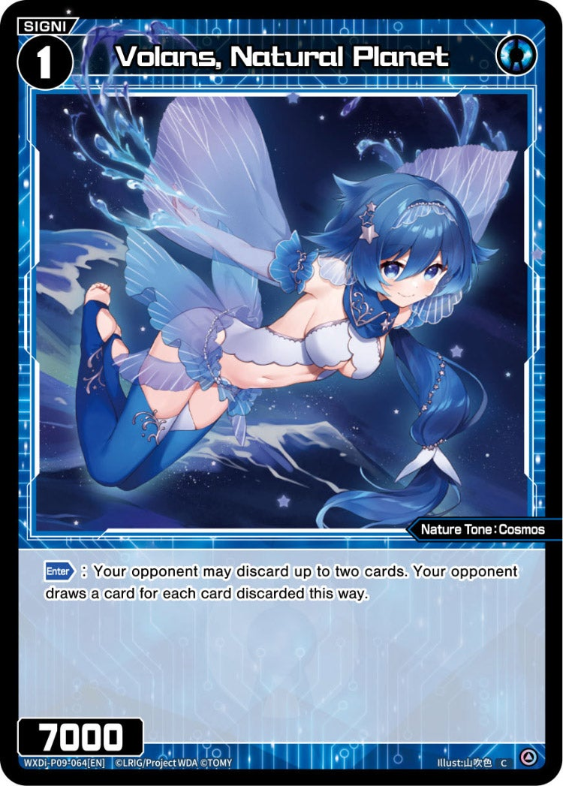

# Volans, Natural Planet

## Thông tin lá

| Trường | Giá trị |
| --- | --- |
| Mã in | WXDi-P09-064[EN] |
| Set | WXDi-P09[EN] |
| Số thứ tự | 064 |
| Loại thẻ | SIGNI |
| Vị trí | Main Deck |
| Số bản | — (set booster, không áp dụng) |
| Màu | Xanh dương |
| Độ hiếm | C,C(P) |
| Minh họa | 山吹色 |
| Level | 1 |
| Limit | — |
| Power | 7000 |
| LRIG type / Class | Nature Tone：Cosmos |
| Team / Master | — |
| Cost | — |
| Grow cost | — |
| Use timing | — |
| Life Burst | Không |

## Card text chính thức

[Enter]: Your opponent may discard up to two cards. Your opponent draws a card for each card discarded this way.

## Power text / Life Burst

—

## Ghi chú minh họa
Artist: 山吹色. Ảnh C được tải từ Card List tiếng Anh.

## FAQ chính thức

**Q. Who chooses how many cards to discard from my opponent's hand with this [Enter] ability?**
A. It is your opponent who chooses how many cards to discard from your opponent's hand with this [Enter] ability.

## Ảnh biến thể

- [C(P)](../images/WXDi-P09-064P-EN.jpg)

## Nguồn
[Card List/FAQ chính thức](https://www.takaratomy.co.jp/products/en.wixoss/card/card.html?card_no=WXDi-P09-064%5BEN%5D ) · [Ảnh thẻ](https://www.takaratomy.co.jp/products/en.wixoss/card/thumb/WXDi-P09-064%5BEN%5D.jpg)
