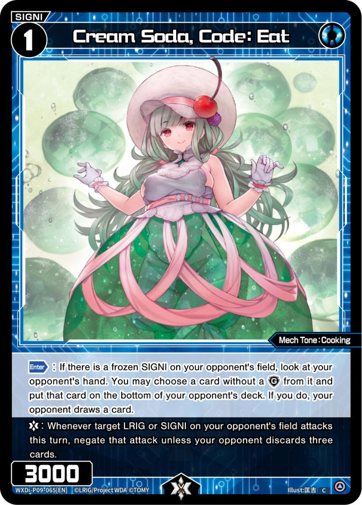

# Cream Soda, Code: Eat

## Thông tin lá

| Trường | Giá trị |
| --- | --- |
| Mã in | WXDi-P09-065[EN] |
| Set | WXDi-P09[EN] |
| Số thứ tự | 065 |
| Loại thẻ | SIGNI |
| Vị trí | Main Deck |
| Số bản | — (set booster, không áp dụng) |
| Màu | Xanh dương |
| Độ hiếm | C,C(P) |
| Minh họa | 匡吉 |
| Level | 1 |
| Limit | — |
| Power | 3000 |
| LRIG type / Class | Mech Tone：Cooking |
| Team / Master | — |
| Cost | — |
| Grow cost | — |
| Use timing | — |
| Life Burst | Có |

## Card text chính thức

[Enter]: If there is a frozen SIGNI on your opponent's field, look at your opponent's hand. You may choose a card without a {Guard Icon} from it and put that card on the bottom of your opponent's deck. If you do, your opponent draws a card.

## Power text / Life Burst

Whenever target LRIG or SIGNI on your opponent's field attacks this turn, negate that attack unless your opponent discards three cards.

## Ghi chú minh họa
Artist: 匡吉. Ảnh C được tải từ Card List tiếng Anh.

## FAQ chính thức

**Q. If the Life Burst of this SIGNI triggers and targets my opponent's LRIG, and that LRIG attacks, causing my opponent to discard three cards from their hand, if that LRIG attacks again due to an effect, will my opponent need to discard additional cards from their hand?**
A. Yes, the Life Burst of 《Cream Soda, Code: Eat》 triggers each time the targeted LRIG or SIGNI attacks, and each time it triggers, unless your opponent discards three cards from their hand, it negates the respective attack.

## Ảnh biến thể

- [C(P)](../images/WXDi-P09-065P-EN.jpg)

## Nguồn
[Card List/FAQ chính thức](https://www.takaratomy.co.jp/products/en.wixoss/card/card.html?card_no=WXDi-P09-065%5BEN%5D ) · [Ảnh thẻ](https://www.takaratomy.co.jp/products/en.wixoss/card/thumb/WXDi-P09-065%5BEN%5D.jpg)
