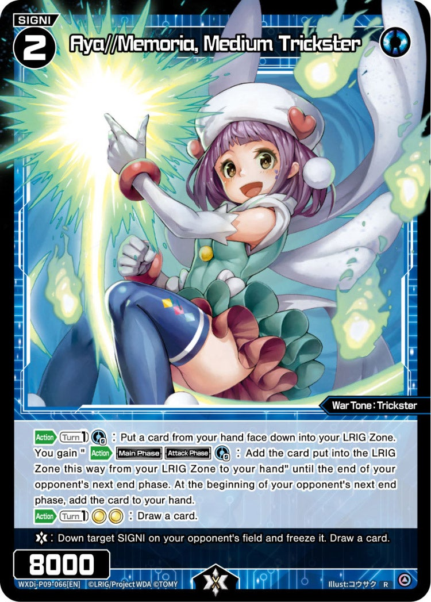

# Aya//Memoria, Medium Trickster

## Thông tin lá

| Trường | Giá trị |
| --- | --- |
| Mã in | WXDi-P09-066[EN] |
| Set | WXDi-P09[EN] |
| Số thứ tự | 066 |
| Loại thẻ | SIGNI |
| Vị trí | Main Deck |
| Số bản | — (set booster, không áp dụng) |
| Màu | Xanh dương |
| Độ hiếm | R,R(P) |
| Minh họa | コウサク |
| Level | 2 |
| Limit | — |
| Power | 8000 |
| LRIG type / Class | War Tone：Trickster |
| Team / Master | — |
| Cost | — |
| Grow cost | — |
| Use timing | — |
| Life Burst | Có |

## Card text chính thức

[Action] {1/Turn} {Bluex0}: Put a card from your hand face down into your LRIG Zone. You gain "[Action] {Main Phase Icon} {Attack Phase Icon} {Bluex0}: Add the card put into the LRIG Zone this way from your LRIG Zone to your hand" until the end of your opponent's next end phase. At the beginning of your opponent's next end phase, add the card to your hand.
[Action] {1/Turn} {Coin Icon} {Coin Icon}: Draw a card.

## Power text / Life Burst

Down target SIGNI on your opponent's field and freeze it. Draw a card.

## Ghi chú minh họa
Artist: コウサク. Ảnh R được tải từ Card List tiếng Anh.

## FAQ chính thức

**Q. What does it mean to put a card face down in the LRIG Zone with the first [Action] ability?**
A. Please put one card from your hand face down around your LRIG, separate from other cards, to keep it distinct. The card put face down is just a card and is neither an LRIG nor a SIGNI.
Furthermore, if multiple copies of 《Aya//Memoria, Medium Trickster》 are on the field, please ensure that it is clear which 《Aya//Memoria, Medium Trickster》 corresponds to which face down card.

**Q. After using the first [Action] ability to put the card face down, if this 《Aya//Memoria, Medium Trickster》 leaves the field, what happens to the face down card?**
A. Even if 《Aya//Memoria, Medium Trickster》 leaves the field, it does not affect the face down card. The effect you gained through its [Action] ability can still be added to your hand, and if the face down card remains on the field until the end of the next your opponent's turn, it will be added to your hand.

**Q. I added a card that I turned face down with the [Action] ability above to my hand with the additional [Action] ability I gained. If it is a SIGNI and I put it on the field, does it return to my hand at the end of my next opponent's turn? If it is a spell, does it return to my hand from trash at the end of my next opponent's turn?**
A. In either case, it does not return. The phrase "the card" in "At the beginning of your opponent's next end phase, add the card to your hand" refers to the face down card, and the card added to your hand from there is treated as a different card.

## Ảnh biến thể

- [R(P)](../images/WXDi-P09-066P-EN.jpg)

## Nguồn
[Card List/FAQ chính thức](https://www.takaratomy.co.jp/products/en.wixoss/card/card.html?card_no=WXDi-P09-066%5BEN%5D ) · [Ảnh thẻ](https://www.takaratomy.co.jp/products/en.wixoss/card/thumb/WXDi-P09-066%5BEN%5D.jpg)
