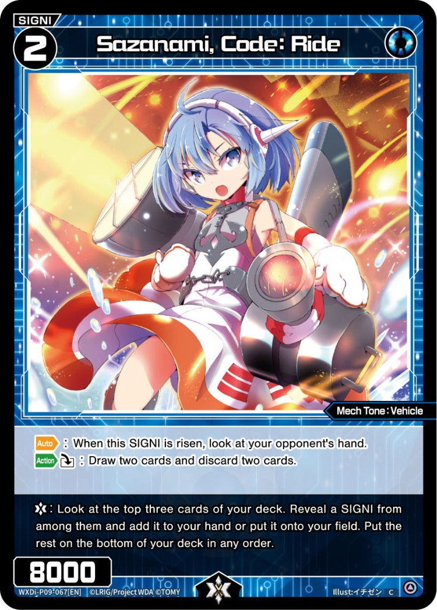

# Sazanami, Code: Ride

## Thông tin lá

| Trường | Giá trị |
| --- | --- |
| Mã in | WXDi-P09-067[EN] |
| Set | WXDi-P09[EN] |
| Số thứ tự | 067 |
| Loại thẻ | SIGNI |
| Vị trí | Main Deck |
| Số bản | — (set booster, không áp dụng) |
| Màu | Xanh dương |
| Độ hiếm | C,C(P) |
| Minh họa | イチゼン |
| Level | 2 |
| Limit | — |
| Power | 8000 |
| LRIG type / Class | Mech Tone：Vehicle |
| Team / Master | — |
| Cost | — |
| Grow cost | — |
| Use timing | — |
| Life Burst | Có |

## Card text chính thức

[Auto]: When this SIGNI is risen, look at your opponent's hand.
[Action] {Down}: Draw two cards and discard two cards.

## Power text / Life Burst

Look at the top three cards of your deck. Reveal a SIGNI from among them and add it to your hand or put it onto your field. Put the rest on the bottom of your deck in any order.

## Ghi chú minh họa
Artist: イチゼン. Ảnh C được tải từ Card List tiếng Anh.

## FAQ chính thức

**Q. After using this SIGNI's [Action] ability to down it, I put a SIGNI with [Rise] on top of this SIGNI. Is the SIGNI with [Rise] also in the down?**
A. No, it is in the up state. A SIGNI with [Rise] put on the field does not inherit the state of the SIGNI that was placed underneath it.

## Ảnh biến thể

- [C(P)](../images/WXDi-P09-067P-EN.jpg)

## Nguồn
[Card List/FAQ chính thức](https://www.takaratomy.co.jp/products/en.wixoss/card/card.html?card_no=WXDi-P09-067%5BEN%5D ) · [Ảnh thẻ](https://www.takaratomy.co.jp/products/en.wixoss/card/thumb/WXDi-P09-067%5BEN%5D.jpg)
